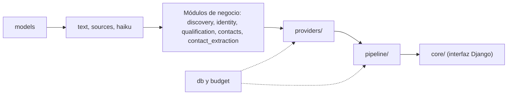
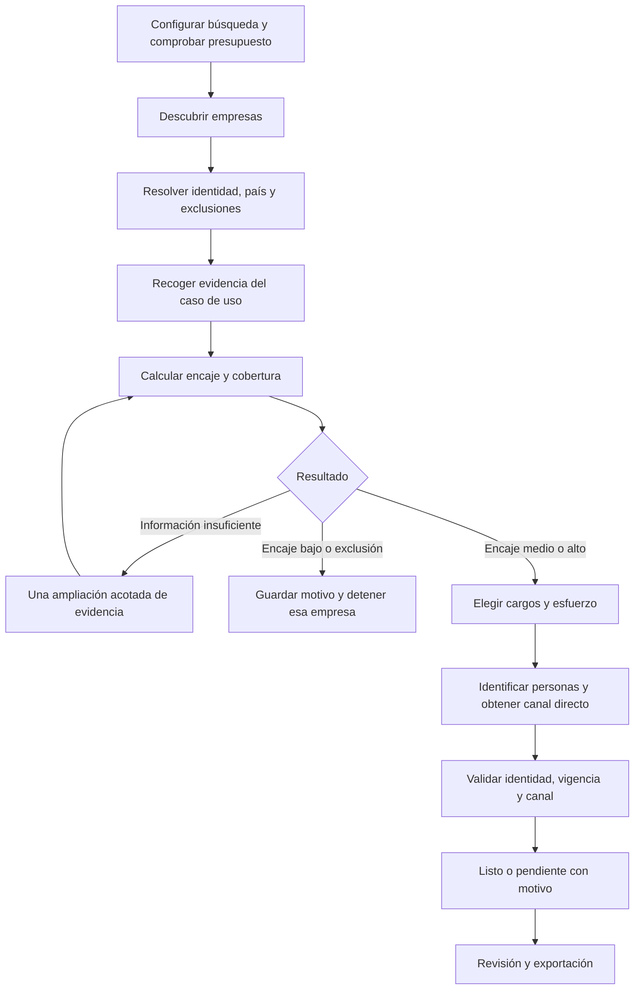
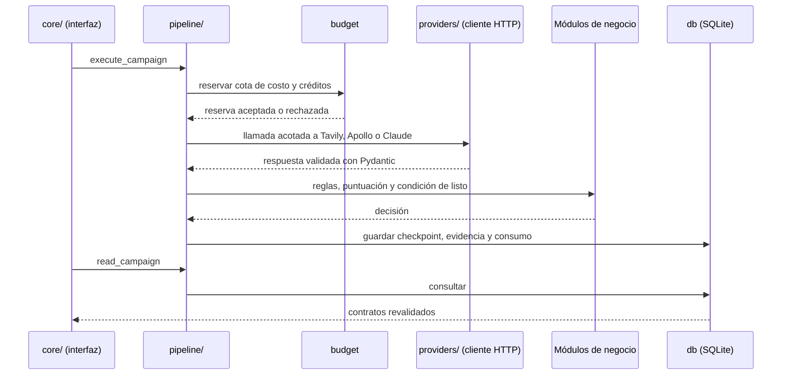
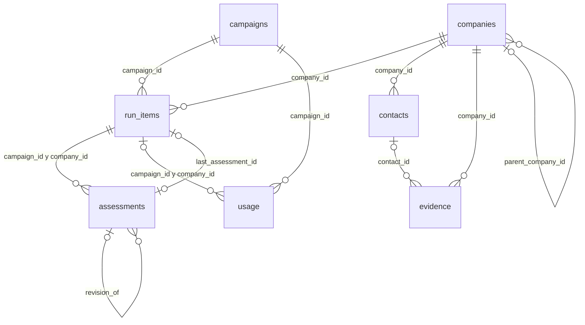

# Arquitectura

Pila tecnológica, límites del sistema, estructura de carpetas, flujo de datos y esquema de la base de datos de Veryfi Prospecting. Forma parte de la documentación de requisitos: ver el [índice](IDEA.md). Cada módulo se describe con más detalle en las guías técnicas de `docs/`; ante cualquier diferencia, manda el código.

## Pila tecnológica

**Python + Django + SQLite**, en una aplicación local de una sola instancia. Django sirve la interfaz de revisión con plantillas renderizadas en el servidor y JavaScript local mínimo, en el lenguaje que domina el equipo; sustituyó a Streamlit por decisión aprobada el 13 de octubre de 2026. Se usa sin ORM, migraciones, cuentas de usuario ni panel de administración: SQLite, gestionada por `prospecting.db`, conserva resultados, uso y estados. La sesión firmada y la memoria del proceso solo guardan estado de presentación y de la ejecución en curso, nunca el presupuesto ni la única copia de una ejecución. El servidor es el de desarrollo de Django, limitado a loopback y no apto para producción [W8].

Usar Pydantic para contratos en límites externos y validación de respuestas; `sqlite3`, `csv`, `json`, `datetime` y otras bibliotecas estándar para persistencia/exportación. Un cliente HTTP compartido y el SDK de Haiku que simplifique la integración. Incluir solamente dependencias necesarias y fijar versiones comprobadas.

No introducir FastAPI, React, Redis, Celery, una base vectorial ni un ORM (tampoco el de Django) en el MVP. Si el piloto exige sesiones simultáneas y trabajos remotos, evaluar entonces API, trabajador y base multiusuario con evidencia de necesidad.

Versiones fijadas en `pyproject.toml` y `.python-version`:

| Componente | Versión o forma de uso | Para qué se usa |
|---|---|---|
| Python | 3.13 (`requires-python = ">=3.13,<3.14"`) | Lenguaje único del proyecto |
| uv | `uv.lock` versionado; se ejecuta todo con `uv run` | Entorno y dependencias reproducibles |
| Django | `django==5.2.18` | Interfaz local: vistas, formularios y plantillas; sin ORM, migraciones, cuentas ni administración |
| Pydantic | `pydantic==2.13.5` | Contratos de datos y validación de las respuestas de proveedores y de Haiku |
| SDK de Anthropic | `anthropic==1.11.0` | Cliente de Claude Haiku (`prospecting/providers/claude.py`) |
| SQLite | Módulo `sqlite3` de la biblioteca estándar | Resultados, consumo y estados (`prospecting/db.py`) |
| Biblioteca estándar | `urllib`, `csv`, `json`, `datetime`, `hashlib` | Transporte HTTP de los proveedores, exportación CSV, serialización y huellas |
| pytest | `pytest==9.1.1` (solo desarrollo) | Pruebas sin red con datos sintéticos |
| Node.js | Opcional | Autochequeo de JavaScript (`node --test tests/js_execution.test.cjs`); no se necesita para ejecutar la aplicación |
| Plantillas, CSS y JavaScript locales | `templates/` y `static/` | Interfaz renderizada en el servidor, sin telemetría ni fuentes remotas |

## Límites del sistema

### Dirección de las dependencias

Las importaciones van en una sola dirección: `models` ← `text`, `sources`, `haiku` ← módulos de negocio (`discovery`, `identity`, `qualification`, `contacts`, `contact_extraction`) ← `providers/` ← `pipeline/` ← `core/`. `db` y `budget` solo se usan desde `providers/` y `pipeline/`. Los módulos de negocio no hacen red, no guardan datos ni reservan gasto; cada adaptador de `providers/` traduce entre el formato de un proveedor y los contratos de §13.2; `pipeline/` los combina con presupuesto y persistencia. Entre los módulos de negocio se permiten `identity → discovery`, para reutilizar `Candidate`, y `contact_extraction → contacts`, para aplicar las reglas comunes de personas y canales. Estas dependencias no habilitan ciclos ni acceso a proveedores, presupuesto o persistencia. La interfaz (`core/`) usa las APIs públicas de `prospecting.pipeline`, los contratos de `models` y la validación de URLs de `sources`; `prospecting` no importa Django ni `core`. `tests/test_architecture.py` comprueba esta dirección y que no haya ciclos dentro de `prospecting`, que `core/` solo importe esas APIs públicas y que `prospecting` no importe Django ni `core`.



Cada capa solo importa de las que la preceden en este orden. El detalle de lo que puede importar cada módulo está en `ALLOWED` de `tests/test_architecture.py`.

### Seguridad y tratamiento de datos

- Claves en variables de entorno o archivo local ignorado por Git, nunca en frontend, prompts, fixtures, capturas ni logs. El documento registra nombres de proveedores, no secretos.
- MVP local en loopback, sin publicar una base de contactos o llaves. El servidor Django solo escucha en 127.0.0.1, sin recargador, con `ALLOWED_HOSTS` local, `DEBUG = False`, protección CSRF y rechazo de conexiones que no vengan de loopback; es el servidor de desarrollo de Django, no apto para producción [W8]. Si se habilita acceso remoto, primero implementar autenticación, permisos y almacenamiento apropiados.
- Guardar solo datos profesionales necesarios. Conservar extractos mínimos de evidencia, no copias masivas de sitios ni PDFs internos completos en proveedores externos.
- Respetar restricciones de acceso y fuentes. No sortear login/CAPTCHA ni automatizar LinkedIn. Registrar datos retirados/restringidos como no disponibles.
- Controlar URLs antes de cualquier extracción: HTTP(S), destinos públicos, sin rutas locales, loopback, redes privadas o metadata cloud. Validar también redirecciones si el cliente realiza la descarga. Limitar tamaño, tipo de contenido y tiempo.
- Escapar contenido externo al mostrarlo, con el autoescape de las plantillas de Django; no marcar contenido externo como seguro. No renderizar HTML arbitrario de fuentes ni instrucciones de páginas como controles de la app. Usar consultas SQL parametrizadas y exportación CSV segura.
- No dar al agente herramientas de envío. La prohibición debe existir en capacidades y pruebas, no solo en el prompt.
- Antes de un piloto, acordar con Veryfi responsable de datos, fuentes permitidas, acceso, retención y eliminación. Como propuesta académica, revisar los datos al terminar la entrega y eliminar lo que no se necesite; no publicar contactos reales en el informe académico.

### Agentes y código normal

«Agente investigador», «evaluador» y «buscador de contactos» son responsabilidades del flujo. No requieren tres procesos autónomos, conversaciones entre agentes ni un framework específico. Para este plazo, funciones Python con estado persistido y herramientas acotadas son suficientes.

En el código, el «agente investigador» son `discovery.py`, `identity.py` y las etapas `pipeline/discovery.py` y `pipeline/research.py`; el «evaluador», `qualification.py` y `pipeline/qualification.py`; el «buscador de contactos», `contacts.py`, `contact_extraction.py`, `providers/apollo.py` y `pipeline/contacts.py`. Cada prompt de Haiku vive junto a su validador en el módulo que lo usa; `haiku.py` fija el modelo y la forma común de la solicitud, y solo `pipeline` invoca `ClaudeClient`.

Todo contenido de páginas, PDFs y respuestas de proveedores es dato no confiable. Nunca puede cambiar el presupuesto, las fuentes permitidas, las instrucciones de búsqueda o habilitar mensajes. Haiku no recibe llaves, acceso de shell, acceso a archivos arbitrarios ni herramientas de comunicación.

## Estructura de carpetas

```text
manage.py                      Arranque del servicio Django local (solo 127.0.0.1)
config/
  settings.py                  Configuración local: loopback, sin ORM ni cuentas
  urls.py                      Rutas del proyecto
  veryfi.json                  Catálogo, perfiles, cargos y rúbrica versionada
  contact_match.json           Pesos versionados del porcentaje de match de contactos
core/                          Interfaz Django: vistas, formularios, ejecución en hilo, presentación y CSV seguro
templates/                     Plantilla base, páginas y fragmentos
static/                        CSS, JavaScript y logotipo locales
prospecting/
  models.py                    Contratos, enumeraciones y validación
  db.py                        SQLite, transacciones y consultas
  budget.py                    Reserva y conciliación de consumo
  text.py                      Recorte y normalización de texto externo
  sources.py                   URLs públicas, dominios no empresariales y resultados de buscador
  haiku.py                     Modelo único y forma común de las solicitudes a Haiku
  discovery.py                 Consultas, candidatos y selección
  identity.py                  Identidad, duplicados y exclusiones
  qualification.py             Rúbrica, puntuación y mapeo a productos/cargos
  contacts.py                  Reglas de personas, canales y condición de listo
  contact_extraction.py        Extracción de contactos públicos con Haiku
  providers/
    http.py                    Cliente HTTP acotado, errores y protocolo de envío
    claude.py                  Cliente de Claude, precios y tope de reserva
    tavily.py                  Operaciones, respuestas, créditos y errores de Tavily
    apollo.py                  Operaciones, respuestas, créditos y errores de Apollo
  pipeline/
    calls.py                   Validar acceso Apollo, reservar, llamar y registrar consumo; plazos
    discovery.py               Descubrimiento e identidad
    research.py                Extracción y ampliación de evidencia
    qualification.py           Calificación
    contacts.py                Personas y canales
    campaign.py                Orquestación de campaña, parada y reanudación
tests/                         Pruebas sin red; fixtures sintéticas
data/                          Base local, caché y exportaciones; fuera de Git
docs/                          Registro de proveedores y evaluación
.env.example                   Nombres de variables, nunca claves reales
pyproject.toml                 Dependencias y configuración de pruebas
README.md                      Instalación, ejecución y demostración
```

Es la estructura del repositorio tras la refactorización R01–R08 y R10 (§17.2; R09 sigue aplazada); si difieren, el árbol del repositorio manda. Una fuente nueva de empresas, evidencia o personas añade `providers/<proveedor>.py` y una fase en la etapa correspondiente, y entrega los contratos y reglas existentes. No añadir capas de repositorios, factorías ni interfaces genéricas de conectores sin necesidad concreta.

## Flujo de datos

### Flujo de investigación



La vuelta de ampliación se permite una sola vez por empresa. Cada paso revisa límites antes de consumir recursos y conserva su resultado aunque los pasos siguientes fallen.

### Recorrido de una llamada

Cada llamada a un proveedor pasa por `prospecting.pipeline`, que reserva el gasto antes de salir a la red y guarda el resultado antes de informarlo. La interfaz solo usa las funciones públicas de `prospecting.pipeline` (por ejemplo `execute_campaign` y `read_campaign`).



El detalle del presupuesto está en [budget-providers.md](budget-providers.md) y el de la orquestación de campañas en [campaign.md](campaign.md).

### Contrato funcional

Contrato funcional:

```text
run_discovery(db, budget, client, campaign_id, …) -> DiscoveryReport
resolve_company_identity(db, campaign_id, company_id, …) -> IdentityReport
extract_company_pages(db, budget, client, campaign_id, company_id, urls, …) -> ExtractReport
qualify_company(db, budget, claude, campaign_id, company_id, …) -> QualificationReport
find_contacts(db, budget, client, campaign_id, company_id, …) -> ContactReport
derive_readiness(assessment, contacts, evidence, limits, now, company) -> BusinessStatus
```

Las cinco primeras están en `prospecting.pipeline`: son las únicas que reservan gasto (mediante `pipeline/calls.py`), llaman a proveedores y guardan checkpoints, y devuelven informes tipados; la UI no interpreta respuestas crudas de APIs. `derive_readiness` (`contacts.py`) y el cálculo de score (`qualification.py`) son código determinista. Toda fuente de personas, presente o futura, entrega `Contact`, `Channel` y `Evidence` y pasa por las mismas reglas de `contacts.py`, sin capas de abstracción especulativas. La ampliación de evidencia (`research_company`) está en `pipeline/research.py` y la orquestación de campaña (`start_campaign`, `run_campaign`, `close_campaign`) en `pipeline/campaign.py`.

### Ejecución y recuperación

Estados técnicos de campaña: `created`, `running`, `completed`, `partial`, `paused_budget`, `failed`. Las etapas de cada empresa se guardan después de cada operación completada.

MVP: una campaña activa por base local, procesamiento secuencial y operación interactiva. La investigación corre en un hilo del proceso del servidor: sigue si se cierra la pestaña mientras el servidor esté abierto, pero detenerlo o reiniciarlo la interrumpe. No prometer trabajo con el servidor detenido, cola persistente ni reanudación automática. Persistir antes de mostrar resultados y recuperar desde la última etapa confirmada si se interrumpe.

Un clic duplicado, el reenvío de un formulario o una recarga de la página deben reutilizar la campaña activa, no duplicarla. Mientras una investigación esté en curso, la interfaz rechaza las acciones que modifican o exportan resultados. En SQLite, comprobar/iniciar ejecución y reservar consumo con transacciones. No mantener una transacción abierta durante una llamada de red.

Aplicar timeout por proveedor. No se reintenta automáticamente una llamada enviada: un fallo transitorio deja la etapa pendiente con su motivo y su reserva hasta conciliar, y reanudar exige una autorización nueva; `Retry-After` se conserva en el error para informar el plazo. Esta decisión, del 14 de octubre de 2026, sustituye el máximo inicial de dos intentos. Diferenciar falta de permisos, cuota agotada, entrada inválida y resultado vacío. No usar una tabla genérica de HTTP para todos los proveedores sin revisar sus semánticas.

Guardar huella de entrada y request_id. Reutilizar respuestas confirmadas, pero no asumir que una API de terceros es idempotente. Ante timeout de una llamada facturable, conservar reserva y conciliar antes de repetir; no liberar dinero por no haber recibido respuesta. Una reserva incierta nunca se vuelve cero silenciosamente.

Los valores con los que se reanuda sin repetir trabajo ni gasto se guardan en SQLite y no cambian al reorganizar código: huellas de solicitud, claves de `RunItem.attempts`, `identity_key`, ids deterministas, textos que marcan resultados de buscador, nombres de clases de los esquemas de Haiku y versiones de prompt (lista en `docs/persistence.md`). T12 conserva estos identificadores históricos y separa las campañas nuevas de Apollo: las anteriores se consultan y exportan, pero no se reanudan bajo el proveedor nuevo. La orquestación de campaña vive en `pipeline/` y llama a las etapas; cada etapa guarda su propio checkpoint.

## Contratos y esquema de datos

### Contratos compartidos

| Objeto | Campos mínimos |
|---|---|
| `Campaign` | id, países, segmentos, filtros, máximo de empresas, límites, versión de rúbrica, estado, timestamps |
| `Company` | id, nombre, dominio, entidad/alias, país de operación, matriz si conocida, segmento, tamaño con fuente |
| `Evidence` | id, company_id, contact_id opcional, afirmación, URL/proveedor, referencia externa, extracto breve, retrieved_at, published_at/updated_at opcionales, tipo y contradicciones |
| `Assessment` | campaign_id, company_id, valores y evidence_ids por criterio, score, coverage, prioridad, productos, cargos, modelo/prompt/rúbrica, explicación |
| `Contact` | id, company_id, nombre, cargo, función, alcance geográfico, evidencia de empleo, vigencia |
| `Channel` | contact_id, tipo, valor, procedencia, estado original/normalizado, fechas, confirmación manual y advertencias |
| `RunItem` | campaign_id, company_id, etapa, resultado comercial, intentos, límites consumidos, stop_reason, revisión y motivo |
| `Usage` | request_id local, campaña/empresa, proveedor/operación, huella de solicitud, reserva, uso/tokens/créditos, costo estimado/final, estado, fechas |

No es necesario crear una tabla por cada clase. Opción concreta: tablas `campaigns`, `companies`, `evidence`, `assessments`, `contacts`, `run_items` y `usage`; canales como JSON validado dentro de `contacts`. La lista de exclusiones no tiene tabla: se lee de un JSON local versionado (`data/exclusions.json`, fuera de Git), y cada coincidencia se guarda como `Evidence` de la empresa con la versión de la lista y la entrada. Las confirmadas por dominio incluyen motivo y alcance; las que solo coinciden por nombre quedan para revisión humana. Claves foráneas e índices para campaña/empresa y restricciones únicas sobre identidades confirmadas. Campos consultados se mantienen como columnas; desgloses y configuración pueden ser JSON.

### Esquema SQLite

`prospecting.db.Database` crea `data/prospecting.sqlite3` solo cuando la ruta no existe. Activa `PRAGMA foreign_keys=ON` en la conexión y fija `PRAGMA user_version=1` al crear la base. No hay migraciones ni funciones de borrado: reabrir una base compatible conserva checkpoints y consumo, y un esquema incompatible, incompleto o corrupto produce un error sin recrear tablas. Las columnas que guardan JSON se validan con `json_valid`; el dinero y los créditos se guardan como texto decimal exacto. El esquema es el de `_SCHEMA` en `prospecting/db.py`.



| Tabla | Columnas |
|---|---|
| `campaigns` | `id`, `countries`, `segments`, `filters`, `max_companies`, `limits`, `rubric_version`, `config_snapshot`, `status`, `created_at`, `updated_at` |
| `companies` | `id`, `name`, `domain`, `entity_name`, `entity_type`, `aliases`, `operating_countries`, `parent_company_id`, `segments`, `size`, `identity_status`, `identity_key`, `provenance` |
| `contacts` | `id`, `company_id`, `name`, `title`, `name_complete`, `current_employment`, `relevant_function`, `identity_status`, `buying_role`, `geographic_scope`, `employment_evidence_ids`, `provenance`, `channels` |
| `evidence` | `id`, `company_id`, `contact_id`, `claim`, `url`, `provider`, `external_reference`, `excerpt`, `retrieved_at`, `published_at`, `updated_at`, `kind`, `source_type`, `contradiction_ids` |
| `run_items` | `campaign_id`, `company_id`, `last_assessment_id`, `stage`, `business_status`, `attempts`, `consumed_limits`, `stop_reason`, `error_message`, `error_stage`, `review_status`, `review_reason`, `reviewed_at`, `updated_at` |
| `assessments` | `id`, `campaign_id`, `company_id`, `criteria`, `fit_score`, `coverage`, `priority`, `products`, `target_roles`, `model_id`, `prompt_version`, `rubric_version`, `explanation`, `created_at`, `revision_of` |
| `usage` | `request_id`, `campaign_id`, `company_id`, `provider`, `operation`, `request_fingerprint`, `account_ref`, `reserved_cost_usd`, `reserved_credits`, `reserved_tokens`, `tokens`, `credits`, `estimated_cost_usd`, `final_cost_usd`, `outlay_usd`, `funding_source`, `status`, `outcome`, `error_message`, `created_at`, `finished_at`, `reconciled_at` |

Claves, valores permitidos e índices de cada tabla:

| Tabla | Restricciones |
|---|---|
| `campaigns` | Clave `id`. `status`: `created`, `running`, `completed`, `partial`, `paused_budget`, `failed`. `max_companies` entre 1 y 20. El índice único parcial `one_active_campaign` permite como máximo una campaña `running` o `paused_budget`. |
| `companies` | Clave `id`. `entity_type`: `legal_entity`, `brand`, `subsidiary`, `unknown`. `identity_status`: `pending`, `confirmed`, `contradicted`. `parent_company_id` referencia a `companies` y no puede ser la propia fila. `identity_key` solo existe con identidad confirmada y es único (`confirmed_identity`). |
| `contacts` | Clave `id`; `company_id` referencia a `companies`; `UNIQUE(id, company_id)`. `identity_status` como en `companies`. `buying_role`: `business_champion`, `technical_champion`, `economic_buyer`, `unknown`. `name_complete`, `current_employment` y `relevant_function` admiten `NULL`, 0 o 1. Índice por empresa. |
| `evidence` | Clave `id`; `company_id` referencia a `companies`; (`contact_id`, `company_id`) referencia a `contacts`. `kind`: `observed`, `inference`, `unknown`. `source_type`: `primary`, `secondary`, `provider`, `manual`. Exige `url` o, en su lugar, `provider` con `external_reference`. Índices por empresa y por contacto. |
| `run_items` | Clave (`campaign_id`, `company_id`). `stage` y `error_stage`: `discovered`, `identity_resolved`, `researched`, `assessed`, `contacts_checked`, `completed`. `business_status`: `ready_preferred`, `ready_alternative`, `needs_channel_confirmation`, `qualified_no_contact`, `insufficient_evidence`, `low_fit`, `excluded` o `NULL`. `review_status`: `pending`, `accepted`, `rejected`. (`last_assessment_id`, `campaign_id`, `company_id`) referencia a `assessments`. Índice por empresa. |
| `assessments` | Clave `id`; `UNIQUE(id, campaign_id, company_id)`. (`campaign_id`, `company_id`) referencia a `run_items`; `revision_of` referencia a otra evaluación y no a la propia. `fit_score` entre 0 y 100 o `NULL`; `coverage` entre 0 y 1. `priority`: `high`, `medium`, `low`, `insufficient_evidence`, `excluded`. Índice por ejecución. |
| `usage` | Clave `request_id`; `campaign_id` referencia a `campaigns` y (`campaign_id`, `company_id`) a `run_items`. `funding_source`: `free_credit`, `prepaid`, `new_outlay` o `NULL`. `status`: `reserved`, `in_flight`, `succeeded`, `failed`, `uncertain`, `reconciled`. `outcome`: `succeeded`, `failed`, `unknown` o `NULL`. Índices por ejecución, por cuenta (`provider`, `account_ref`, `status`) y por huella de solicitud. |

Las reglas de escritura, la procedencia, las transacciones y los identificadores guardados (huellas, claves de intentos, ids deterministas) están en [persistence.md](persistence.md).

### Archivos de configuración y datos locales

| Archivo | Contenido | En Git |
|---|---|---|
| `config/veryfi.json` | Catálogo provisional, perfiles, cargos, `rubric_v1` y límites iniciales (`VeryfiConfig`); cada campaña guarda una instantánea | Sí |
| `config/contact_match.json` | Pesos de `contact_match_v1` (`ContactMatchConfig`); `PROSPECTING_CONTACT_MATCH_PATH` permite usar otro archivo | Sí |
| `data/exclusions.json` | Lista local de exclusiones comerciales; no tiene tabla propia | No |
| `data/provider-access.json` | Cupos y referencias de acceso comprobadas (`ProviderAccess`); nunca claves ni permisos | No |
| `data/prospecting.sqlite3` | Base SQLite con resultados, evidencia y consumo | No |
| `.env` y variables de entorno | `TAVILY_API_KEY`, `ANTHROPIC_API_KEY` y `APOLLO_API_KEY`; `.env.example` solo lista los nombres | `.env` no; `.env.example` sí |
