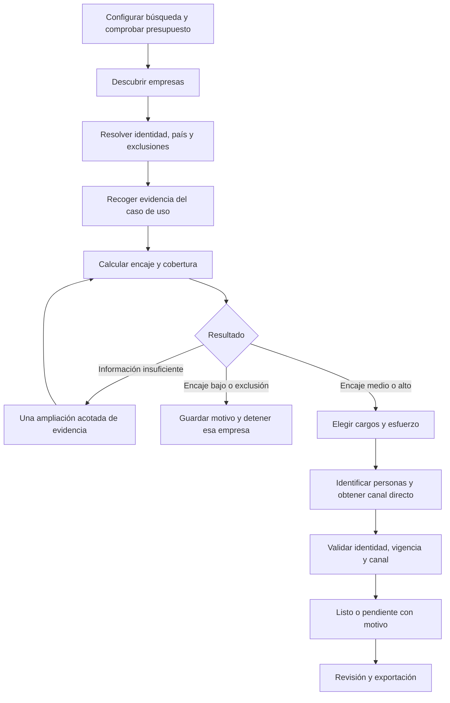

# Veryfi Prospecting: descubrimiento y calificación de clientes potenciales

Versión 1.4 — 12 de octubre de 2026. Fechas en America/Bogota.

Documento de producto, plan de implementación y guía para agentes de código del proyecto de Sistemas de Información para Veryfi. Recoge las decisiones tomadas con el equipo. Las reglas numéricas de calificación, las metas de evaluación y la arquitectura son propuestas iniciales para implementar y validar; no representan criterios comerciales ya certificados por Veryfi.

## 1. Idea y resultado esperado

Construir una aplicación que descubra empresas potencialmente interesadas en Veryfi, investigue sus necesidades, explique qué producto podría servirles y encuentre personas pertinentes con medios directos de comunicación. El esfuerzo invertido en encontrar contactos dependerá del encaje de cada empresa, de la evidencia disponible y del presupuesto restante.

El resultado es una lista priorizada de prospectos revisables por ventas. Cada ficha debe responder:

1. ¿Qué empresa es, en qué mercado opera y qué hace?
2. ¿Qué necesidad observable podría resolver Veryfi y con qué producto?
3. ¿Por qué merece atención y qué información falta?
4. ¿Quién sería una persona pertinente, qué función cumple y cómo puede contactarla ventas?
5. ¿De dónde salió cada dato, cuándo se consultó y cuánto costó investigarlo?

**La aplicación no envía correos, mensajes, invitaciones ni WhatsApps, no llama, no agenda reuniones y no ejecuta campañas comerciales.** El equipo de ventas decide y realiza cualquier contacto fuera de la aplicación.

Una empresa atractiva sin canal directo queda como **pendiente de contacto**, no como prospecto listo. Encontrar una persona y encontrar cómo comunicarse con ella son resultados diferentes.

## 2. Decisiones acordadas y valores iniciales

| Tema | Decisión |
|---|---|
| Finalidad | Prototipo académico con posibilidad de evolucionar a piloto para Veryfi |
| Segmentos | FinTech/software y CPG/consumo masivo/fidelización, con criterios y cargos diferentes |
| Mercado | Latinoamérica; primeras pruebas en Colombia y México |
| Tamaño | Priorizar medianas y grandes; admitir pequeñas con necesidad clara |
| Autonomía | El usuario configura una búsqueda; el sistema descubre, evalúa y profundiza automáticamente dentro de sus límites |
| Contacto mínimo | Persona pertinente con al menos un medio directo; preferencia por correo o teléfono |
| LinkedIn | Alternativa útil, de menor prioridad; debe existir una posibilidad de mensajería, no solamente una URL |
| Equipo | Tres desarrolladores, principalmente Python, y una integrante encargada de documentación académica |
| Primer sprint/MVP | 16 de octubre de 2026 |
| Entrega final académica | 6 de noviembre de 2026 |
| Presupuesto | Mantener gastos bajos; máximo USD 20 para todo el primer sprint |
| Modelo de IA | Haiku 5.5 para interpretación y clasificación; el equipo declara acceso API |
| Proveedores de datos | MVP: Tavily Search/Extract para empresas y evidencia; Hunter para búsqueda de personas y correos profesionales, sujeto a acceso y cupo verificados. Apollo y X-Ray Search quedan como ampliaciones condicionales para la entrega final |
| Validación | El Head of LATAM Engineering puede revisar resultados y ayudar con ejemplos y exclusiones |

Valores de implementación propuestos: hasta 20 empresas analizadas por ejecución, uno a tres contactos por empresa, ejecución a demanda, interfaz y explicaciones en español, lectura de fuentes en español e inglés. Colombia y México son la muestra inicial; no se afirma cobertura validada de toda Latinoamérica. Brasil/portugués requieren una evaluación posterior.

La ruta inicial de contactos para el MVP será Hunter Domain Search sobre dominios confirmados y cargos pertinentes; si la respuesta resulta insuficiente, se podrá complementar con fuentes públicas encontradas mediante Tavily y Hunter Email Finder para personas identificadas. No asumir que un endpoint o crédito está habilitado por tener una clave: comprobar condiciones reales de acceso, costo, límites y procedencia antes de hacer llamadas.

El presupuesto posterior al 16 de octubre no está definido. No renovar el cupo de USD 20 automáticamente: mientras no haya una nueva decisión, los siguientes sprints deben usar el remanente, créditos gratuitos y pruebas sin consumo.

## 3. Contexto de Veryfi y relación con la entrega académica

La empresa es **Veryfi Inc. (veryfi.com)**, proveedora de captura documental, extracción de datos mediante OCR/API, enriquecimiento, antifraude y soluciones para programas de fidelización. No es una aplicación genérica de cobranza.

La entrega de análisis de negocio identifica el tiempo invertido en investigar cuentas, conectar necesidades con productos e identificar personas correctas. También señala que faltan mediciones claras del proceso actual. La herramienta cubre ese trabajo de investigación previo a la interacción comercial [D1, pp. 21–25].

Los materiales distinguen promotores técnicos, promotores de negocio y decisores económicos. Por eso el sistema no debe buscar siempre directores de ventas/comercial/finanzas: el cargo depende del problema detectado [D2, pp. 7–9; D3, pp. 11–12].

El anexo de la primera entrega menciona una idea anterior de prospección LATAM para CPG que incluía agendar llamadas. Ese texto es un antecedente documental. La solicitud actual amplía a ambos segmentos y excluye contactar o agendar [D1, p. 30].

Las diapositivas mezclan períodos históricos, productos experimentales y ejemplos posteriores. Sus precios, umbrales de clientes y estados de desarrollo no se convierten automáticamente en reglas actuales. El Head of LATAM Engineering deberá validar el catálogo comercial usado por el prototipo.

La tecnología de Veryfi es lo que se busca vender. Esta aplicación no necesita integrar su API OCR para hacer prospección. Tampoco necesita reproducir su infraestructura AWS/GPU ni sus herramientas internas.

## 4. Alcance funcional

### 4.1 Primer sprint

- Crear una búsqueda con países, segmento o ambos, palabras clave opcionales y límite de empresas.
- Descubrir empresas reales desde fuentes externas, sin exigir una lista previa.
- Identificar dominio, actividad, operación en el país y posibles duplicados.
- Buscar evidencia de un caso de uso y asociarlo al catálogo de Veryfi.
- Calificar con criterios visibles y registrar datos desconocidos.
- Asignar una investigación de contactos básica o profunda según prioridad.
- Encontrar personas y canales con la ruta inicial Tavily + Hunter, condicionada a acceso comprobado; verificar relación laboral, cargo, procedencia y estado del canal.
- Mostrar resultados parciales, evidencia, motivos de detención y consumo.
- Guardar ejecuciones y permitir revisión y exportación CSV.
- Aplicar límites de gasto, exclusiones y la prohibición de contactar.

### 4.2 Hasta la entrega final

- Ajustar reglas con la revisión de Veryfi y evaluar empresas no usadas para ajustarlas.
- Evaluar Apollo como segunda fuente de personas/enriquecimiento si los resultados del MVP muestran cobertura insuficiente y su cuenta permite acceso y consumo controlado.
- Evaluar X-Ray Search con buscadores tradicionales para localizar perfiles públicos indexados de LinkedIn; implementarlo solo si aporta cobertura y respeta las restricciones de §11.2.
- Evaluar la clasificación de Haiku con evidencia revisada y ajustar los prompts cuando sea necesario.
- Mejorar recuperación de ejecuciones, frescura de datos y manejo de fallos.
- Entregar documentación reproducible, evaluación y límites observados.

### 4.3 Fuera del alcance de esta entrega

Envío comercial, campañas, CRM completo, integraciones de escritura con CRM, entrenamiento de modelos propios, predicción estadística de compra, scraping automatizado de LinkedIn, agentes que operen cuentas personales, seguimiento continuo programado, infraestructura distribuida y plataforma multiusuario de producción.

La carga de una lista de empresas para investigación puede añadirse después si aporta valor; no sustituye el descubrimiento solicitado. Un portal público o piloto remoto necesita una decisión de despliegue y acceso separada.

## 5. Clientes objetivo, señales y personas

| Perfil | Señales públicas de encaje | Solución candidata | Personas a investigar |
|---|---|---|---|
| FinTech de gastos/reembolsos | Usuarios suben recibos; gestión de gastos; conciliación con tarjetas | OCR de recibos/facturas, Lens, antifraude | Product Manager, Head/VP of Product, Engineering Manager/Director, CTO |
| Software de pagos/AP/ERP | Recepción de facturas, captura de documentos, conciliación y cuentas por pagar | API documental, captura, validación y enriquecimiento | Producto, Ingeniería, responsable de AP/operaciones financieras según producto |
| CPG y marcas | Promociones que piden tickets, códigos o comprobantes; recompensas por compra | Validación de compras, antifraude, Lens, WhatsApp y datos de productos | Marketing Director, Brand Manager, Loyalty/CRM Manager, Trade Marketing, Consumer Insights |
| Plataformas/agencias de fidelización | Implementan campañas o programas para marcas; necesitan validar compras | Integración de APIs o soluciones de campañas | Producto/Tecnología, responsable de fidelización, director de cuentas pertinente |

El último perfil es un subperfil candidato del segmento de fidelización, pendiente de validación comercial. No ampliar a todos los tipos de agencias.

Reglas de interpretación:

- Una campaña concreta que solicita recibos es evidencia más fuerte que la frase genérica «empresa innovadora».
- Un producto con captura de comprobantes demuestra un caso de uso, no que su proveedor actual falle o que desee cambiarlo.
- Tamaño, financiación y expansión son aproximaciones al potencial; no demuestran presupuesto disponible ni volumen documental.
- No atribuir necesidades solamente por pertenecer a una industria.
- Buscar cargos en español e inglés y verificar función, no solo palabras del título.
- Priorizar quien gestiona el proceso o producto. Compras puede intervenir después; un cargo alto no demuestra autoridad para esta compra.
- Identificar país y alcance del puesto. Un responsable regional puede servir para Colombia y México aunque resida en otro país.
- Separar marca, filial, agencia y matriz. Compartir dominio no autoriza fusionarlas ni asumir que compran juntas.
- Los casos de éxito de Veryfi sirven para aprender patrones y proponer exclusiones. Los retailers mencionados en una promoción no son automáticamente clientes de Veryfi [D4].

## 6. Experiencia de uso

1. **Configurar.** Seleccionar Colombia/México, uno o ambos segmentos y hasta 20 empresas. Ver límites, proveedores disponibles y presupuesto restante antes de ejecutar.
2. **Investigar.** Mostrar etapa, empresas procesadas, consumo y resultados parciales. No pedir aprobación entre empresas.
3. **Revisar.** Tabla filtrable por país, segmento, prioridad y disponibilidad de canal. Al abrir una ficha, mostrar caso de uso, puntuación desglosada, evidencia y contactos.
4. **Corregir.** Marcar aceptado, rechazado o pendiente con motivo. Confirmar manualmente mensajería en LinkedIn cuando sea el único canal. No enviar nada para comprobarlo.
5. **Exportar.** Exportación principal de prospectos listos, y otra opción explícita para todos los resultados con su estado.

La pantalla debe distinguir «listo según reglas» de «aceptado por Veryfi». La revisión humana es posterior al flujo automático; no hace falta revisar cada empresa antes de investigar.

Para exportación: una fila por persona, repetir los datos de la empresa y conservar identificadores. Las empresas sin personas solo aparecerán en la exportación de todos los resultados, con campos vacíos y su motivo. El CSV incluirá enlace/fuente, fechas, estado del canal, puntuación, revisión y advertencias relevantes. Proteger las celdas de texto contra fórmulas de hoja de cálculo.

## 7. Flujo de investigación



La vuelta de ampliación se permite una sola vez por empresa. Cada paso revisa límites antes de consumir recursos y conserva su resultado aunque los pasos siguientes fallen.

### 7.1 Descubrimiento

Usar Tavily Search como primera opción. Construir consultas combinando país, perfil y señal de necesidad: gestión de gastos con recibos, plataformas de pagos con facturas, promociones con tickets o programas de puntos por compras. Empezar con plantillas; Haiku solo reformula cuando los resultados sean insuficientes y quede presupuesto.

Fuentes candidatas: páginas de producto, centros de ayuda, campañas y sus condiciones, directorios sectoriales públicos, asociaciones FinTech, noticias corporativas y vacantes. Los directorios y noticias generan candidatos; confirmar identidad y actividad en una fuente primaria cuando sea posible.

Para una ejecución con ambos países y segmentos, intentar cinco empresas por combinación (CO/FinTech, CO/CPG, MX/FinTech, MX/CPG). Es una estrategia de prueba, no una cuota obligatoria: informar si alguna combinación no ofrece suficientes resultados y no rellenar con empresas inventadas.

Límites iniciales: ocho consultas de descubrimiento, hasta diez resultados por consulta y hasta sesenta candidatos brutos antes de deduplicar/seleccionar un máximo de veinte empresas para análisis. No interpretar «20 empresas» como «20 prospectos garantizados».

### 7.2 Identidad y exclusiones

Resolver nombre, dominio oficial, país de operación y segmento. El dominio es una señal de identidad, acompañado de nombre/entidad/país y alias verificados. No deduplicar solo por nombre ni solo por dominio cuando existan filiales o marcas distintas.

Aplicar una lista local de clientes actuales, oportunidades en curso y exclusiones suministrada por Veryfi. Guardar motivo, fuente y alcance de la exclusión: entidad, país o grupo. Si esa lista aún no existe, mostrar «exclusiones comerciales no validadas»; no afirmar que se comprobó ausencia de relación previa.

Excluir antes del enriquecimiento: entidades inequívocamente fuera del país/segmento elegido, dominios no empresariales, duplicados confirmados y cuentas explícitamente excluidas. Identidad ambigua pasa a pendiente. Un tamaño desconocido o pequeño no produce exclusión automática.

### 7.3 Evidencia

Guardar hechos atómicos, cada uno con texto breve, URL o referencia de proveedor, fecha de consulta y, si existe, fecha de publicación/actualización. Mantener separadas afirmación observada, inferencia y dato desconocido.

No tratar el resumen del buscador como confirmación definitiva de cargo o canal: sirve para localizar la fuente. Un dato de proveedor puede usarse como tal, identificándolo, aunque no traiga URL pública; conservar referencia de registro y estado que devolvió.

Reutilizar evidencia vigente entre ejecuciones. Valor inicial de caché: siete días para páginas/búsquedas y treinta días para datos de contacto. Consultar una página hoy no convierte en actual una noticia antigua. Si hay contradicciones o indicios de cambio de cargo, suspender la condición de listo y revisar.

## 8. Calificación explicable

### 8.1 Qué significa la puntuación

La puntuación mide **encaje observable con la oferta**, no probabilidad de compra, solvencia ni intención demostrada. Mostrar aparte cobertura de información, calidad de fuentes y disponibilidad de contacto. Encontrar un email no aumenta el encaje comercial.

Primera rúbrica, pendiente de calibración con Veryfi:

| Criterio | Peso | 1: señal fuerte | 0,5: señal parcial |
|---|---:|---|---|
| Necesidad documental/validación | 35 | Producto o programa explícitamente recibe/procesa comprobantes relevantes | Flujo documental compatible, sin detalle completo |
| Correspondencia con una oferta | 25 | Relación concreta entre problema y capacidad validada de Veryfi | Relación plausible con una capacidad, requiere confirmación |
| Escala/potencial | 20 | Operación amplia o volumen relevante documentado | Empresa mediana o despliegue limitado con evidencia |
| Capacidad de adoptar la solución | 10 | Producto digital, integración o canal apropiado comprobado | Infraestructura parcial compatible |
| Momento de oportunidad | 10 | Lanzamiento, expansión o campaña vigente relevante | Iniciativa reciente, sin calendario claro |

Valor `0`: evidencia explícita incompatible con ese criterio. Valor `null`: no se pudo determinar. Ausencia de noticias, de ingresos públicos o de emails no se convierte en cero. Guardar la evidencia y la justificación del nivel asignado.

El significado de los criterios depende del segmento: en FinTech se observa el producto y su procesamiento documental; en CPG, la mecánica de campañas y validación. No exigir equipo de desarrollo propio a una marca que podría usar una solución de campaña gestionada.

Para ordenar tamaño, usar inicialmente rangos de empleados como aproximación operativa: menos de 50, 50–249 y 250 o más. No son definiciones legales de empresa pequeña/mediana/grande. Conservar cifras, rangos y fuentes originales. No inventar empleados, ingresos, ACV o volumen para completar la rúbrica.

### 8.2 Cálculo y clasificación

Con pesos que suman 100 y valores conocidos entre 0 y 1:

```text
known_weight = suma de pesos de criterios cuyo valor no es null
coverage = known_weight / 100
fit_score = 100 * suma(peso * valor conocido) / known_weight
si known_weight == 0: fit_score = null; coverage = 0
```

Reglas, en este orden:

1. Exclusión confirmada: `excluded` y motivo, sin búsqueda de personas.
2. Identidad o criterios de necesidad/correspondencia desconocidos, o contradicción material: `insufficient_evidence`.
3. `fit_score >= 75`, `coverage >= 0.75`, necesidad igual a 1, correspondencia al menos 0,5 y una fuente primaria que respalde el caso de uso: `high`.
4. `fit_score >= 50`, `coverage >= 0.60`, necesidad y correspondencia al menos 0,5: `medium`.
5. Evidencia suficiente (`coverage >= 0.60`) y fallo de los umbrales de encaje anteriores: `low`.
6. En cualquier otro caso: `insufficient_evidence`.

Ejemplo: valores 1, 1, 0,5, 1 y null producen 80 puntos ponderados sobre 90 conocidos: encaje 88,9 y cobertura 90 %. Si cumple las condiciones de evidencia, prioridad alta. Una empresa de la que solo conocemos la escala tendría puntuación 100, pero cobertura 20 % y quedaría con evidencia insuficiente.

Los umbrales son la versión `rubric_v1`. No cambiarlos silenciosamente entre ejecuciones. Guardar versión, entradas y resultado; los ajustes humanos generan una nueva evaluación o una revisión registrada.

## 9. Esfuerzo de búsqueda y parada

La prioridad decide cuánto investigar, no autoriza gasto ilimitado. Todos los números siguientes son topes iniciales por empresa y deben poder reducirse desde configuración.

| Etapa/nivel | Búsqueda web | Extracción de páginas | Personas/enriquecimiento | Tope de tiempo activo |
|---|---:|---:|---|---:|
| Análisis inicial | Hasta 2 consultas | Hasta 3 páginas | Sin enriquecimiento | 90 s |
| Evidencia insuficiente | 1 consulta adicional | Hasta 2 páginas adicionales | Ninguno hasta recalificar | 45 s adicionales |
| Prioridad media | Hasta 2 consultas adicionales | Hasta 2 páginas adicionales | 1 persona; hasta 1 enriquecimiento por proveedor habilitado | 90 s adicionales |
| Prioridad alta | Hasta 4 consultas adicionales | Hasta 4 páginas adicionales | Hasta 3 personas; hasta 3 enriquecimientos por proveedor habilitado | 180 s adicionales |
| Prioridad baja/excluida | Ninguna adicional | Ninguna adicional | Ninguno | Detener |

En búsqueda de personas, permitir como máximo una consulta al proveedor especializado para prioridad media y dos para alta (Hunter Domain Search en el MVP; Apollo solo si se habilita después). Los límites de personas y enriquecimientos permanecen vigentes. Cada llamada a Hunter Finder/Verifier y cada verificación de correo consume el cupo correspondiente; máximo una verificación por candidato/canal salvo que el proveedor devuelva procesamiento pendiente. No recorrer paginación ilimitada ni repetir búsquedas agotadas.

Secuencia de menor a mayor esfuerzo:

1. Revisar evidencia ya obtenida, páginas corporativas y canales laborales publicados.
2. Consultar Hunter Domain Search sobre el dominio confirmado, filtrando por función y cargos del perfil, si la cuenta tiene acceso y cupo; complementar candidatos con búsqueda web pública mediante Tavily cuando haga falta.
3. Verificar nombre completo, entidad, cargo actual, pertinencia y procedencia. Enriquecer solamente candidatos con identidad y función pertinentes; preferir correo corporativo y no solicitar emails personales.
4. Si falta correo, usar Hunter Email Finder con nombre y dominio confirmados. Reutilizar las verificaciones vigentes incluidas en la respuesta y usar Verifier solo cuando corresponda y haya cupo; no fabricar direcciones.
5. Usar teléfono directo/extensión o WhatsApp profesional publicado cuando haya asociación explícita a la persona.
6. Mantener LinkedIn como alternativa; si es el único canal, pedir confirmación humana de que ventas puede usar mensajería.

Detener la empresa cuando se consiga un contacto pertinente con correo/teléfono utilizable. Si solo hay LinkedIn, agotar únicamente el cupo restante de ese nivel para intentar un canal preferido. Hasta tres personas es un máximo, no una obligación de consumir más después de encontrar un resultado útil.

También detener por tiempo, presupuesto, cuota, falta de nuevas fuentes, proveedor no disponible o límite de intentos. Guardar `stop_reason`. Una búsqueda «exhaustiva» significa agotar ese plan acotado, no explorar toda la web.

Tope inicial global de ejecución: 45 minutos, además de los límites de llamadas y dinero. Los tiempos son objetivos de operación; medirlos en pruebas y conservar resultados parciales al alcanzarlos.

## 10. Persona y canal útiles

### 10.1 Requisitos de la persona

Nombre completo identificado, empresa/entidad correcta, cargo respaldado, función relevante y evidencia de relación vigente sin contradicciones pendientes. Guardar función en la compra como `business_champion`, `technical_champion`, `economic_buyer` o `unknown`; un título por sí solo no confirma autoridad de compra.

Cuando Hunter, una búsqueda web o una futura integración con Apollo entreguen identificadores o nombres incompletos, conservarlos como candidatos; no completar apellidos con IA. Resolver identidad con evidencia del proveedor o fuentes públicas antes de marcar listo.

### 10.2 Reglas por canal

| Canal | Cuándo cuenta como directo utilizable | Qué no basta |
|---|---|---|
| Email laboral | Asociación a la persona y verificación válida vigente del proveedor; o publicación nominal en fuente corporativa actual sin verificación negativa | Patrón inferido, correo de otra persona, dirección genérica, dato inválido |
| Teléfono | Número laboral directo o central con extensión nominal, fuente que vincule a la persona y formato/país comprobados | Central general sin ruta a la persona; número cuyo titular se desconoce |
| WhatsApp | Fuente profesional que lo anuncie como canal de esa persona | Suponer que todo móvil tiene WhatsApp |
| LinkedIn | Identidad/cargo comprobados y vendedor confirma mensajería disponible desde su cuenta | URL aislada, asumir InMail disponible o mandar invitación para probar |
| Otro canal | Vía profesional nominal y acceso directo confirmado manualmente | Formulario genérico de empresa o red social sin mensajería comprobada |

La publicación corporativa de un email prueba que se ofrece como contacto, no garantiza entregabilidad. La validación de formato de un teléfono no prueba que atienda. Mostrar siempre esta diferencia. No enviar mensajes, hacer llamadas ni generar notificaciones para verificar un canal.

Conservar estado original del proveedor y un estado normalizado: `verified`, `published_professional`, `accept_all`, `unknown`, `invalid` o `manual_confirmed`. `accept_all`/`unknown` no son por sí solos verificados. Si además existe publicación nominal corporativa vigente, conservar ambos hechos y la advertencia; una verificación `invalid` bloquea ese canal hasta resolverla.

Frescura propuesta: verificación de email hasta 30 días; evidencia fechada del puesto preferiblemente dentro de 180 días, o directorio corporativo actual consultado. Si la fuente no permite estimar vigencia, marcar incertidumbre y requerir revisión antes de listo. Estos plazos son reglas del prototipo, no garantías del proveedor.

### 10.3 Estados de negocio

- `ready_preferred`: encaje alto/medio, persona pertinente y correo/teléfono/WhatsApp profesional utilizable.
- `ready_alternative`: mismos requisitos, pero solamente canal alternativo directo confirmado.
- `needs_channel_confirmation`: existe candidato a canal, por ejemplo LinkedIn, pero falta comprobar acceso o asociación.
- `qualified_no_contact`: empresa de encaje alto/medio sin persona/canal utilizable después del cupo.
- `insufficient_evidence`: no se puede decidir con información suficiente.
- `low_fit`: encaje bajo con evidencia suficiente.
- `excluded`: exclusión confirmada.

Las interrupciones técnicas no son estados comerciales: registrar aparte la ejecución y `stop_reason`. Una empresa puede estar calificada y haber quedado sin contacto por falta de cuota.

## 11. Proveedores y estrategia de integración

Documentación consultada el 10 de octubre de 2026. Acceso, planes y consumo se deben verificar con las cuentas del equipo antes de activar cada integración.

| Componente | Elección inicial y función | Condición y alternativa |
|---|---|---|
| Búsqueda/evidencia | Tavily Search/Extract | Usar créditos gratuitos primero, búsqueda básica y URLs seleccionadas. Sin Research/Crawl amplio por defecto [W1] |
| Personas (MVP) | Hunter Domain Search | Buscar personas por dominio de empresa confirmado y cargos relevantes. Complementar con Tavily cuando haya cobertura insuficiente; habilitar solo con acceso, consumo y fuentes verificados [W3] |
| Correo (MVP) | Hunter Email Finder/Verifier | Obtener correo laboral de una persona identificada y verificarlo solo cuando sea necesario; conservar estado, fuentes y fechas. No sustituye validación del cargo [W3] |
| Personas (ampliación condicional) | Apollo People Search y enriquecimiento selectivo | Evaluar después del MVP si mejora cobertura/pertinencia a un costo justificable y la cuenta permite los endpoints. Search no entrega email/teléfono; no habilitar por defecto [W2] |
| Interpretación y clasificación | Haiku 5.5 | Extraer hechos, evaluar criterios, relacionar casos de uso y producir explicación breve con referencias; Python aplica el cálculo y las reglas [W4] |
| Revisión de perfiles | LinkedIn manual | No depender de una API abierta de Sales Navigator ni automatizar el sitio [W5] |

Alternativas evaluadas, no integraciones obligatorias: Exa para descubrimiento semántico de empresas/personas y Brave Search API para búsqueda general [W6, W7]. Cambiar de buscador solo si la evaluación muestra una limitación concreta; no integrar varios a la vez por previsión.

Apollo (evaluación para la entrega final, no T06 del MVP): si las pruebas de cobertura justifican incorporarlo, considerar `mixed_people/api_search` y `people/match`, verificando correspondencia actual entre persona y empresa incluso si aparece un empleo anterior. Mantener desactivados enriquecimiento de móvil y waterfall de costo variable. Verificar parámetros, respuesta y disponibilidad en la cuenta antes de desarrollar o consumir [W2].

Hunter (primera ruta de T06): comprobar Domain Search con filtros de cargo/departamento y fuentes; usar Email Finder únicamente para candidatos identificados cuyo correo no se obtuvo. Activar Verifier solo si hace falta, reutilizando una verificación incluida y vigente. Confirmar acceso, parámetros, créditos y procedencia con la cuenta real. Su clave pública de prueba devuelve datos ficticios: sirve para probar contratos, nunca para presentar resultados como prospectos reales [W3].

No añadir endpoints de secuencias, envío, creación de campañas ni sincronización de contactos a plataformas externas. Las integraciones de prospección usan lectura/búsqueda/enriquecimiento aunque algunas llamadas HTTP sean POST.

### 11.1 Comprobación de acceso del primer día

Probar una muestra mínima y registrar para cada proveedor: cuenta disponible, endpoints permitidos, crédito inicial, límite, costo real de la llamada y resultado. Crear un pequeño registro `docs/provider-check.md` sin secretos ni datos personales innecesarios.

Para el MVP, comprobar primero la ruta Hunter y sus créditos. Si Domain Search o Finder no están disponibles, continuar con evidencia pública mediante Tavily, dejar el contacto como pendiente cuando no exista canal útil y registrar la limitación; la incorporación anticipada de Apollo exige una decisión explícita. No comprar un plan que supere el presupuesto ni sustituir contactos reales por datos inventados. La obtención automática de canales directos debe demostrarse con resultados reales para considerarla validada.

### 11.2 Extensión futura: X-Ray Search para descubrimiento de contactos

Para la entrega final del 6 de noviembre, se propone **evaluar** una estrategia de X-Ray Search que descubra posibles contactos profesionales mediante motores de búsqueda tradicionales y consultas restringidas a perfiles públicos indexados de LinkedIn. No forma parte de T06 ni es condición para cerrar el MVP; su implementación dependerá de cobertura, costo, acceso y tiempo disponibles.

El objetivo es reducir la dependencia de proveedores de enriquecimiento comercial para la identificación inicial de personas y ampliar las fuentes disponibles.

**Flujo propuesto:**

1. Identificar los cargos relevantes para una empresa previamente calificada.
2. Generar consultas de búsqueda combinando empresa, cargo, país y términos equivalentes en español e inglés.
3. Restringir los resultados a perfiles públicos de LinkedIn mediante operadores como `site:linkedin.com/in/`.
4. Extraer de los resultados autorizados del buscador el nombre aparente, cargo, URL y fragmento disponible.
5. Contrastar la identidad y vigencia del cargo con fuentes adicionales cuando sea necesario.
6. Utilizar Apollo, Hunter u otras fuentes autorizadas para obtener y verificar canales de contacto profesional.
7. Registrar los candidatos junto con sus fuentes, fechas y estados de verificación.

**Ejemplo de consulta:**

`site:linkedin.com/in/ "Trade Marketing Manager" "Nombre Empresa" Colombia`

**Restricciones:**

- No automatizar la descarga de perfiles completos desde LinkedIn.
- No utilizar scraping de LinkedIn ni herramientas de navegación automatizada no autorizadas.
- Respetar las condiciones de acceso y reutilización de información de los buscadores y fuentes.
- No considerar un fragmento indexado como prueba suficiente de empleo actual.
- Una URL de LinkedIn no constituye por sí sola un canal de contacto utilizable.
- Mantener los criterios de verificación y contactabilidad establecidos en la sección 10.

**Evaluación futura:**

Antes de integrar esta funcionalidad, comparar su cobertura, pertinencia, costo y actualidad de los perfiles frente a la ruta Tavily + Hunter y, si está disponible, Apollo. Si no aporta una mejora verificable, documentar la evaluación y aplazar la integración.

### 11.3 Evolución de la búsqueda de contactos

T06 implementa una sola ruta principal viable: Tavily para evidencia pública y Hunter para personas/canales. La validación de identidad, puesto, canal, procedencia y estado comercial debe ser independiente de la fuente concreta y reutilizar los contratos `Contact`, `Channel` y `Evidence` (§13.2); no construir una plataforma genérica de conectores.

Para la entrega final, considerar Apollo y X-Ray Search como extensiones **opcionales**, no como proveedores obligatorios ni como permiso para ampliar presupuesto. Decidir a partir de una muestra de empresas calificadas: personas pertinentes halladas, cobertura de canales utilizables, actualidad de fuentes, crédito/costo consumido y fallos. Solo implementar si el incremento es útil y se mantiene el alcance sin contacto comercial automático.

## 12. Uso de IA y protección de decisiones

### 12.1 Haiku

Haiku recibe un catálogo breve de capacidades autorizadas de Veryfi, datos de campaña y evidencia recuperada. Devuelve un objeto validable con hechos, `evidence_ids`, criterios, productos candidatos, cargos sugeridos, incertidumbres y una explicación corta. Debe poder devolver `null`/desconocido.

No usar su memoria como fuente de contactos, empresas o cargos actuales. No permitir que invente URLs ni referencias: cada `evidence_id` debe existir en el conjunto suministrado. La validación programática comprueba referencias y valores; la revisión de calidad comprueba que la fuente respalde la afirmación.

Límite inicial por petición: aproximadamente 6.000 tokens de entrada y 1.000 de salida, con esfuerzo bajo cuando esté soportado. Partir/seleccionar evidencia antes de enviar páginas completas. Registrar modelo exacto, versión de prompt, uso y costo. Revisar parámetros actuales del modelo; no copiar configuraciones de modelos anteriores sin verificar [W4].

### 12.2 Evaluación y decisiones en Python

Haiku evalúa los criterios de la rúbrica y la pertinencia de los cargos usando la evidencia suministrada. Python valida la respuesta, calcula la puntuación y cobertura, aplica umbrales y decide el esfuerzo de búsqueda. Las decisiones de presupuesto, exclusión, parada y condición de listo permanecen en código determinista.

Si una respuesta de Haiku falla o no supera la validación después de los intentos permitidos, conservar la evidencia y marcar la evaluación como pendiente. No escalar automáticamente a un modelo más caro.

Con un conjunto separado de validación, medir errores, latencia y costo total del flujo. La confianza del modelo sirve como señal técnica; no mostrarla como porcentaje de compra ni asumir calibración para este dominio sin medición.

### 12.3 Agentes y código normal

«Agente investigador», «evaluador» y «buscador de contactos» son responsabilidades del flujo. No requieren tres procesos autónomos, conversaciones entre agentes ni un framework específico. Para este plazo, funciones Python con estado persistido y herramientas acotadas son suficientes.

En el código, el «agente investigador» son `discovery.py`, `identity.py` y las etapas `pipeline/discovery.py` y `pipeline/research.py`; el «evaluador», `qualification.py` y `pipeline/qualification.py`; el «buscador de contactos», `contacts.py`, `contact_extraction.py`, `providers/hunter.py` y `pipeline/contacts.py`. Cada prompt de Haiku vive junto a su validador en el módulo que lo usa; `haiku.py` fija el modelo y la forma común de la solicitud, y solo `pipeline` invoca `ClaudeClient`.

Todo contenido de páginas, PDFs y respuestas de proveedores es dato no confiable. Nunca puede cambiar el presupuesto, las fuentes permitidas, las instrucciones de búsqueda o habilitar mensajes. Haiku no recibe llaves, acceso de shell, acceso a archivos arbitrarios ni herramientas de comunicación.

## 13. Arquitectura mínima

**Python + Django + SQLite**, en una aplicación local de una sola instancia. Django sirve la interfaz de revisión con plantillas renderizadas en el servidor y JavaScript local mínimo, en el lenguaje que domina el equipo; sustituyó a Streamlit por decisión aprobada el 13 de octubre de 2026. Se usa sin ORM, migraciones, cuentas de usuario ni panel de administración: SQLite, gestionada por `prospecting.db`, conserva resultados, uso y estados. La sesión firmada y la memoria del proceso solo guardan estado de presentación y de la ejecución en curso, nunca el presupuesto ni la única copia de una ejecución. El servidor es el de desarrollo de Django, limitado a loopback y no apto para producción [W8].

Usar Pydantic para contratos en límites externos y validación de respuestas; `sqlite3`, `csv`, `json`, `datetime` y otras bibliotecas estándar para persistencia/exportación. Un cliente HTTP compartido y el SDK de Haiku que simplifique la integración. Incluir solamente dependencias necesarias y fijar versiones comprobadas.

No introducir FastAPI, React, Redis, Celery, una base vectorial ni un ORM (tampoco el de Django) en el MVP. Si el piloto exige sesiones simultáneas y trabajos remotos, evaluar entonces API, trabajador y base multiusuario con evidencia de necesidad.

Las importaciones van en una sola dirección: `models` ← `text`, `sources`, `haiku` ← módulos de negocio (`discovery`, `identity`, `qualification`, `contacts`, `contact_extraction`) ← `providers/` ← `pipeline/` ← `core/`. `db` y `budget` solo se usan desde `providers/` y `pipeline/`. Los módulos de negocio no hacen red, no guardan datos ni reservan gasto; cada adaptador de `providers/` traduce entre el formato de un proveedor y los contratos de §13.2; `pipeline/` los combina con presupuesto y persistencia. Entre los módulos de negocio se permiten `identity → discovery`, para reutilizar `Candidate`, y `contact_extraction → contacts`, para aplicar las reglas comunes de personas y canales. Estas dependencias no habilitan ciclos ni acceso a proveedores, presupuesto o persistencia. La interfaz (`core/`) usa las APIs públicas de `prospecting.pipeline`, los contratos de `models` y la validación de URLs de `sources`; `prospecting` no importa Django ni `core`. `tests/test_architecture.py` comprueba esta dirección dentro de `prospecting` y que no haya ciclos; `tests/test_initialization.py` comprueba que importar `prospecting` no carga Django.

### 13.1 Estructura orientativa

```text
manage.py                      Arranque del servicio Django local (solo 127.0.0.1)
config/
  settings.py                  Configuración local: loopback, sin ORM ni cuentas
  urls.py                      Rutas del proyecto
  veryfi.json                  Catálogo, perfiles, cargos y rúbrica versionada
core/                          Interfaz Django: vistas, formularios, ejecución en hilo, presentación y CSV seguro
templates/                     Plantilla base, páginas y fragmentos
static/                        CSS, JavaScript y logotipo locales
prospecting/
  models.py                    Contratos, enumeraciones y validación
  db.py                        SQLite, transacciones y consultas
  budget.py                    Reserva y conciliación de consumo
  text.py                      Recorte y normalización de texto externo
  sources.py                   URLs públicas, dominios no empresariales y resultados de buscador
  haiku.py                     Modelo único y forma común de las solicitudes a Haiku
  discovery.py                 Consultas, candidatos y selección
  identity.py                  Identidad, duplicados y exclusiones
  qualification.py             Rúbrica, puntuación y mapeo a productos/cargos
  contacts.py                  Reglas de personas, canales y condición de listo
  contact_extraction.py        Extracción de contactos públicos con Haiku
  providers/
    http.py                    Cliente HTTP acotado, errores y protocolo de envío
    claude.py                  Cliente de Claude, precios y tope de reserva
    tavily.py                  Operaciones, respuestas, créditos y errores de Tavily
    hunter.py                  Operaciones, respuestas, créditos y errores de Hunter
  pipeline/
    calls.py                   Reservar, llamar y registrar consumo; plazos
    discovery.py               Descubrimiento e identidad
    research.py                Extracción y ampliación de evidencia
    qualification.py           Calificación
    contacts.py                Personas y canales
    campaign.py                Orquestación de campaña, parada y reanudación
tests/                         Pruebas sin red; fixtures sintéticas
data/                          Base local, caché y exportaciones; fuera de Git
docs/                          Registro de proveedores y evaluación
.env.example                   Nombres de variables, nunca claves reales
pyproject.toml                 Dependencias y configuración de pruebas
README.md                      Instalación, ejecución y demostración
```

Es la estructura del repositorio tras la refactorización R01–R10 (§17.2); si difieren, el árbol del repositorio manda. Una fuente nueva de empresas, evidencia o personas añade `providers/<proveedor>.py` y una fase en la etapa correspondiente, y entrega los contratos y reglas existentes. No añadir capas de repositorios, factorías ni interfaces genéricas de conectores sin necesidad concreta.

### 13.2 Contratos compartidos

| Objeto | Campos mínimos |
|---|---|
| `Campaign` | id, países, segmentos, filtros, máximo de empresas, límites, versión de rúbrica, estado, timestamps |
| `Company` | id, nombre, dominio, entidad/alias, país de operación, matriz si conocida, segmento, tamaño con fuente |
| `Evidence` | id, company_id, contact_id opcional, afirmación, URL/proveedor, referencia externa, extracto breve, retrieved_at, published_at/updated_at opcionales, tipo y contradicciones |
| `Assessment` | campaign_id, company_id, valores y evidence_ids por criterio, score, coverage, prioridad, productos, cargos, modelo/prompt/rúbrica, explicación |
| `Contact` | id, company_id, nombre, cargo, función, alcance geográfico, evidencia de empleo, vigencia |
| `Channel` | contact_id, tipo, valor, procedencia, estado original/normalizado, fechas, confirmación manual y advertencias |
| `RunItem` | campaign_id, company_id, etapa, resultado comercial, intentos, límites consumidos, stop_reason, revisión y motivo |
| `Usage` | request_id local, campaña/empresa, proveedor/operación, huella de solicitud, reserva, uso/tokens/créditos, costo estimado/final, estado, fechas |

No es necesario crear una tabla por cada clase. Opción concreta: tablas `campaigns`, `companies`, `evidence`, `assessments`, `contacts`, `run_items`, `usage` y `exclusions`; canales como JSON validado dentro de `contacts`. Claves foráneas e índices para campaña/empresa y restricciones únicas sobre identidades confirmadas. Campos consultados se mantienen como columnas; desgloses y configuración pueden ser JSON.

Contrato funcional:

```text
run_discovery(db, budget, client, campaign_id, …) -> DiscoveryReport
resolve_company_identity(db, campaign_id, company_id, …) -> IdentityReport
extract_company_pages(db, budget, client, campaign_id, company_id, urls, …) -> ExtractReport
qualify_company(db, budget, claude, campaign_id, company_id, …) -> QualificationReport
find_contacts(db, budget, client, campaign_id, company_id, …) -> ContactReport
derive_readiness(assessment, contacts, evidence, limits, now, company) -> BusinessStatus
```

Las cinco primeras están en `prospecting.pipeline`: son las únicas que reservan gasto (mediante `pipeline/calls.py`), llaman a proveedores y guardan checkpoints, y devuelven informes tipados; la UI no interpreta respuestas crudas de APIs. `derive_readiness` (`contacts.py`) y el cálculo de score (`qualification.py`) son código determinista. Toda fuente de personas, presente o futura, entrega `Contact`, `Channel` y `Evidence` y pasa por las mismas reglas de `contacts.py`, sin capas de abstracción especulativas. La ampliación de evidencia (`research_company`) está en `pipeline/research.py` y la orquestación de campaña (`start_campaign`, `run_campaign`, `close_campaign`) en `pipeline/campaign.py`.

### 13.3 Ejecución y recuperación

Estados técnicos de campaña: `created`, `running`, `completed`, `partial`, `paused_budget`, `failed`. Las etapas de cada empresa se guardan después de cada operación completada.

MVP: una campaña activa por base local, procesamiento secuencial y operación interactiva. La investigación corre en un hilo del proceso del servidor: sigue si se cierra la pestaña mientras el servidor esté abierto, pero detenerlo o reiniciarlo la interrumpe. No prometer trabajo con el servidor detenido, cola persistente ni reanudación automática. Persistir antes de mostrar resultados y recuperar desde la última etapa confirmada si se interrumpe.

Un clic duplicado, el reenvío de un formulario o una recarga de la página deben reutilizar la campaña activa, no duplicarla. Mientras una investigación esté en curso, la interfaz rechaza las acciones que modifican o exportan resultados. En SQLite, comprobar/iniciar ejecución y reservar consumo con transacciones. No mantener una transacción abierta durante una llamada de red.

Aplicar timeout por proveedor, como máximo dos intentos para errores transitorios y respeto a `Retry-After` dentro del tiempo restante. Diferenciar falta de permisos, cuota agotada, entrada inválida y resultado vacío. No usar una tabla genérica de HTTP para todos los proveedores sin revisar sus semánticas.

Guardar huella de entrada y request_id. Reutilizar respuestas confirmadas, pero no asumir que una API de terceros es idempotente. Ante timeout de una llamada facturable, conservar reserva y conciliar antes de repetir; no liberar dinero por no haber recibido respuesta. Una reserva incierta nunca se vuelve cero silenciosamente.

Los valores con los que se reanuda sin repetir trabajo ni gasto se guardan en SQLite y no cambian al reorganizar código: huellas de solicitud, claves de `RunItem.attempts`, `identity_key`, ids deterministas, textos que marcan resultados de buscador, nombres de clases de los esquemas de Haiku y versiones de prompt (lista en `docs/persistence.md`). La orquestación de campaña vive en `pipeline/` y llama a las etapas; cada etapa guarda su propio checkpoint.

## 14. Presupuesto y control de gasto

**USD 20 es el máximo agregado del primer sprint, entre todos los desarrolladores, Haiku, datos, pruebas y ejecuciones. No es un cupo por agente, cuenta, empresa ni corrida.** No se autoriza comprar suscripciones ni recargar automáticamente por describir este plan.

Distribución de planificación, no cotización ni compra:

| Partida | Reserva máxima inicial |
|---|---:|
| Interpretación y clasificación con Haiku | USD 3 |
| Búsqueda/extracción web | USD 2 |
| Obtención/verificación de contactos | USD 10 |
| Margen para incertidumbre, errores o cargos adicionales | USD 5 |
| Total | USD 20 |

Priorizar créditos gratuitos. Si un proveedor exige una compra mínima que no cabe, usar otra vía; una reserva de USD 10 no implica que exista un plan comprable por ese valor. Las reservas pueden redistribuirse por decisión del equipo sin aumentar el total.

Implementación del control:

1. Contabilizar tanto créditos consumidos como costo económico estimado; distinguir crédito gratuito, saldo prepagado y nuevo desembolso. No contar dos veces compra y consumo del mismo saldo, pero tampoco ignorar consumo de una cuenta ya financiada.
2. Designar a una persona responsable del cupo compartido. Preferir que las pruebas reales salgan de una sola instancia/control de presupuesto; las demás usan fixtures. Bases independientes no coordinan por sí solas un límite global.
3. Antes de cada llamada, reservar una cota superior de costo y de créditos según la operación/configuración real. Para LLM incluir entrada, máximo de salida y tokens facturables adicionales aplicables.
4. Rechazar la llamada si gasto conciliado + reservas + nueva reserva supera el límite operativo. Limitar operación automática a USD 15, dejando USD 5 de margen hasta conciliación.
5. Conciliar con respuesta y saldo del proveedor. Mostrar estimado y confirmado por separado. Si no se puede acotar un precio, no habilitar esa operación pagada.
6. Mantener un límite inicial por campaña de USD 2 y por empresa de USD 0,25, siempre subordinados al acumulado global. El límite puede reducir cantidad de resultados; nunca se elimina para cumplir una cuota de prospectos.
7. Deshabilitar recargas, waterfall de costo variable y teléfonos enriquecidos de pago en el primer sprint. Usar topes del proveedor cuando estén disponibles.

Referencia de costos para comprender órdenes de magnitud, no garantizar facturas: Tavily publica 1.000 créditos gratuitos mensuales; una búsqueda básica usa uno [W1]. Haiku 5.5 publica USD 0,10/M tokens de entrada y USD 0,50/M de salida para prompts de hasta 100.000 tokens [W4]. Con esos supuestos, 100 consultas de 6.000 tokens de entrada y 1.000 de salida serían USD 0,11 de inferencia, antes de otros consumos. El dato de contacto y la política de consulta pueden pesar más que la inferencia; medir el flujo completo.

El indicador de gasto de la aplicación es una estimación controlada, no reemplaza la facturación. Capturar consumo real al final de cada sesión de pruebas. Si un tercero cambia condiciones o falta acceso, detener y registrar la limitación.

## 15. Seguridad y tratamiento de datos

- Claves en variables de entorno o archivo local ignorado por Git, nunca en frontend, prompts, fixtures, capturas ni logs. El documento registra nombres de proveedores, no secretos.
- MVP local en loopback, sin publicar una base de contactos o llaves. El servidor Django solo escucha en 127.0.0.1, sin recargador, con `ALLOWED_HOSTS` local, `DEBUG = False`, protección CSRF y rechazo de conexiones que no vengan de loopback; es el servidor de desarrollo de Django, no apto para producción [W8]. Si se habilita acceso remoto, primero implementar autenticación, permisos y almacenamiento apropiados.
- Guardar solo datos profesionales necesarios. Conservar extractos mínimos de evidencia, no copias masivas de sitios ni PDFs internos completos en proveedores externos.
- Respetar restricciones de acceso y fuentes. No sortear login/CAPTCHA ni automatizar LinkedIn. Registrar datos retirados/restringidos como no disponibles.
- Controlar URLs antes de cualquier extracción: HTTP(S), destinos públicos, sin rutas locales, loopback, redes privadas o metadata cloud. Validar también redirecciones si el cliente realiza la descarga. Limitar tamaño, tipo de contenido y tiempo.
- Escapar contenido externo al mostrarlo, con el autoescape de las plantillas de Django; no marcar contenido externo como seguro. No renderizar HTML arbitrario de fuentes ni instrucciones de páginas como controles de la app. Usar consultas SQL parametrizadas y exportación CSV segura.
- No dar al agente herramientas de envío. La prohibición debe existir en capacidades y pruebas, no solo en el prompt.
- Antes de un piloto, acordar con Veryfi responsable de datos, fuentes permitidas, acceso, retención y eliminación. Como propuesta académica, revisar los datos al terminar la entrega y eliminar lo que no se necesite; no publicar contactos reales en el informe académico.

## 16. Plan de implementación y responsables

Las fechas siguientes son hitos propuestos. El equipo debe iniciar por comprobar acceso a datos: es la dependencia que más puede afectar la utilidad del MVP.

### 16.1 Primer sprint: 10–16 de octubre

| Fecha | Trabajo | Evidencia de terminación |
|---|---|---|
| 10–11 oct. | Contratos, catálogo/rúbrica inicial, cuentas y pruebas mínimas de acceso; solicitar ejemplos a Veryfi | Contratos compartidos y registro de proveedor con acceso, consumo y limitaciones reales |
| 11–12 oct. | Descubrimiento en los dos segmentos/países y persistencia de fuentes | Empresas reales con dominio y evidencia; duplicados/exclusiones identificados |
| 12–13 oct. | Haiku, evaluación por criterios, cálculo en Python y límites de esfuerzo | Desglose explicable; casos desconocidos y negativos diferenciados |
| 12–14 oct. | T06: comprobar acceso y desarrollar la primera ruta Tavily + Hunter (Domain Search y Finder según necesidad) | Al menos una ficha real con persona/canal respaldados si el proveedor lo permite; sin envío y con límites documentados |
| 14–15 oct. | Integración UI, CSV, recuperación, presupuesto y pruebas críticas | Flujo completo desde criterios hasta resultado; fallos simulados conservan datos |
| 15–16 oct. | Ejecución pequeña, revisión con Veryfi y preparación de demo | Resultados reales, métricas iniciales, gasto conciliado y límites documentados |

Distribución para tres desarrolladores:

| Responsable | Área principal | Entregable y coordinación |
|---|---|---|
| Dev 1 | Descubrimiento y evidencia | Tavily, identidad, fuentes y exclusiones; entrega `Company`/`Evidence` |
| Dev 2 | Calificación e integración del flujo | Haiku, rúbrica, presupuesto/persistencia y contratos compartidos; responsable de integrar cambios |
| Dev 3 | Contactos e interfaz | Proveedor de personas/canal, estados de contacto, interfaz Django y CSV; empezar por una ruta viable |
| Documentación | Informe y evaluación | Trazabilidad con análisis de negocio, decisiones, métricas, validación y capturas sin datos personales |

Repartir código por módulo después de acordar contratos; un responsable por módulo compartido:

| Responsable | Módulos |
|---|---|
| Dev 1 | `discovery.py`, `identity.py`, `sources.py`, `text.py`, `providers/tavily.py`, `pipeline/discovery.py`, `pipeline/research.py` |
| Dev 2 (contratos e integración) | `models.py`, `db.py`, `budget.py`, `haiku.py`, `qualification.py`, `providers/http.py`, `providers/claude.py`, `pipeline/__init__.py`, `pipeline/calls.py`, `pipeline/qualification.py`, `pipeline/campaign.py` |
| Dev 3 | `contacts.py`, `contact_extraction.py`, `providers/hunter.py`, `pipeline/contacts.py`, `manage.py`, `config/settings.py`, `config/urls.py`, `core/`, `templates/`, `static/` |

Integrar diariamente, no dejar UI, gasto y contratos para el último día. Si la carga de Dev 2/3 crece, redistribuir tareas terminadas manteniendo dueño del contrato.

### 16.2 Siguientes hitos

| Período | Objetivo | Resultado |
|---|---|---|
| 17–23 oct. | Revisar falsos positivos y cobertura Hunter; evaluar Apollo como ampliación condicional | Calidad y cobertura medidas; integrar Apollo solo si el acceso y la mejora justifican el costo |
| 24–30 oct. | Validar Haiku en empresas nuevas y evaluar X-Ray Search de perfiles indexados | Tabla de calidad, costo, tiempo y fallos; decisión documentada sobre X-Ray sin retrasar la validación de Haiku |
| 31 oct.–5 nov. | Corregir fallos, congelar alcance y preparar entrega | Instalación reproducible, pruebas, demo sin consumo obligatorio y documento académico |
| 6 nov. | Entrega | Código del prototipo, guía, evaluación, limitaciones y propuesta de condiciones para piloto |

Los sprints posteriores no presuponen gasto nuevo. Usar evidencia cacheada y fixtures para desarrollo; una ampliación de presupuesto se decide aparte.

## 17. Guía de trabajo para agentes de código

### 17.1 Instrucciones comunes

Usar este documento como referencia del producto y sus criterios de aceptación. Revisar contratos, dependencias y código existente antes de implementar cada tarea, y coordinar los cambios compartidos con los otros desarrolladores.

Implementar el siguiente bloque completo más pequeño y su verificación, sin añadir herramientas o funciones de alcance posterior. Usar Haiku para interpretación y clasificación, y mantener la rúbrica y los prompts versionados; no construir una plataforma de agentes genérica.

Cada cambio va al módulo de su responsabilidad (§13.1): una regla de negocio, al módulo de negocio; el formato, los errores o el consumo de un proveedor, a `providers/<proveedor>.py`; una reserva, llamada, checkpoint o recuperación, a `pipeline/`. Un commit `refactor:` conserva la conducta: las pruebas existentes pasan con sus aserciones intactas y solo cambian rutas de importación.

Para cada tarea, entregar: archivos modificados, conducta añadida, prueba ejecutada, resultado y limitación pendiente. Una API simulada no demuestra acceso real. Los datos sintéticos deben ser visibles como tales y nunca mezclarse en una demo de resultados reales.

No abrir cuentas, comprar planes, desplegar públicamente, enviar mensajes ni generar claves como parte implícita de una tarea de programación. Esas operaciones deben corresponder a instrucciones específicas y al presupuesto acordado.

### 17.2 Backlog ejecutable

| ID | Encargo al agente | Dependencias | Criterio de aceptación |
|---|---|---|---|
| T01 | Definir contratos mínimos, SQLite y configuración de catálogo/rúbrica | Ninguna | Guardar/leer campaña, evidencia, evaluación, contactos y uso; secretos excluidos |
| T02 | Implementar reserva/conciliación de presupuesto y cliente de proveedores | T01 | Una llamada sin saldo no sale a la red; timeout facturable mantiene reserva |
| T03 | Integrar descubrimiento y extracción con Tavily | T01–T02 | Resuelve candidatos reales, conserva fuentes y respeta países/límites |
| T04 | Resolver entidades, duplicados y lista de exclusiones | T03 | No fusiona filiales sin evidencia; excluye cuentas indicadas antes de enriquecer |
| T05 | Implementar investigación con Haiku y calificación determinista | T01–T04 | Score reproducible, `null` separado de cero y referencias válidas |
| T06 | Implementar búsqueda de personas y canal directo con la ruta habilitada | T02, T05 | Persona vinculada a empresa/cargo; canal con procedencia y estado; sin envío |
| T07 | Orquestar etapas, límites de esfuerzo, parada y recuperación | T02–T06 | Continúa desde pasos completados, guarda resultados parciales y no repite clics |
| T08 | Construir UI, revisión humana y CSV | Contratos T01; integrar con T07 | Lanza desde criterios, explica estados, confirma alternativa y exporta sin fórmulas |
| T09 | Probar invariantes, validar pertinencia de contactos y ejecutar lote real pequeño | T07–T08 | Informe de pruebas, priorización de cargos comprobada, resultados reales diferenciados de fixtures y gasto conciliado |
| T10 | Incorporar revisión de Veryfi y validar la calificación con Haiku | T09 | Rúbrica/versiones registradas, conjunto de evaluación separado y conclusión sustentada |
| T11 | Preparar entrega y condiciones del piloto | T09–T10 | README reproducible, informe, demo y límites de producción explícitos |

Foco de T09 acordado tras la prueba local del 12 de octubre de 2026:

- El usuario considera satisfactorios el descubrimiento y la afinidad empresarial obtenidos con Tavily y Haiku en la prueba revisada. Registrar esta valoración como observación de esa muestra, no como validación general de precisión comercial; conservar el flujo y medir su calidad en el lote.
- Concentrar la revisión de contactos en encontrar primero a quienes gestionan el proceso o producto: ordenar los cargos preferibles por perfil, incluir variantes en español e inglés y comprobar que los filtros de Hunter y las búsquedas públicas usan esa prioridad antes de ampliar por departamentos (§5, §9 y §10).
- Revisar y corregir la selección de T06 para que un candidato poco pertinente no bloquee el cupo de personas investigadas ni desplace candidatos idóneos encontrados después. Distinguir ese cupo de los créditos de Hunter: las llamadas ya realizadas siguen contabilizadas y no se recuperan ni se reinicia el consumo. Conservar los candidatos pendientes y su procedencia; no aumentar los topes para compensar la selección.
- Verificar con fixtures sintéticos el caso de un candidato inicial fuera de los cargos objetivo seguido de otro pertinente. Auditar también qué fragmentos de la evidencia llegan a Haiku para extraer personas, evitando perder información nominal relevante por la selección de fragmentos, sin exceder los límites del prompt ni tratar nombres aislados como empleo confirmado.
- En el lote real autorizado, medir pertinencia, cobertura y consumo por contacto útil (§18), y registrar por qué los candidatos no resultaron elegibles. Un correo verificado no sustituye la comprobación de cargo, función, empleo vigente y alcance geográfico. Estos ajustes corrigen la búsqueda y selección existentes; no requieren añadir proveedores ni relajar las reglas de listo.

T03/T04, T05 y T06/T08 pueden desarrollarse por personas distintas usando los contratos acordados. La ejecución real contra proveedores debe compartir control de presupuesto. T10 no bloquea el MVP del 16 de octubre. T06 prioriza Hunter como ruta inicial, condicionada a comprobación de acceso; Apollo y X-Ray no son requisitos del MVP.

Posibles tareas adicionales para el proyecto final (propuestas, **aún no issues creados**):

| ID propuesto | Encargo | Dependencias | Criterio para implementarlo |
|---|---|---|---|
| T12 | Evaluar e integrar Apollo como fuente adicional de personas/canales | T06, T09; acceso y presupuesto autorizados | Mayor cobertura/pertinencia medida frente a Hunter, con procedencia, validación y gasto controlados |
| T13 | Evaluar e integrar X-Ray Search mediante buscadores públicos | T06, T09; resultados indexados utilizables | Descubrimiento adicional con fuentes contrastadas; sin scraping de LinkedIn ni URL aislada como canal útil |

T12 y T13 son independientes y opcionales; pueden limitarse a evaluación documentada si la evidencia no justifica implementarlas. No se añaden como dependencias de T11 ni habilitan consumo nuevo.

Refactorización modular (aprobada el 12 de octubre de 2026). Conserva la conducta; cada tarea es un commit `refactor:` verificable que lleva el código hacia §13.1. R01–R08 y R10 están hechas; R09 es opcional y queda aplazada hasta decidir T12, porque solo elimina duplicación en el protocolo de envío:

| ID | Encargo al agente | Dependencias | Criterio de aceptación |
|---|---|---|---|
| R01 | Fijar identificadores persistidos y reglas de dependencia | Ninguna | Huellas, ids deterministas, marcadores, esquema y ledger fijados; cambiar un carácter de un payload o del esquema hace fallar las pruebas |
| R02 | Dividir `pipeline` en un paquete por etapas | R01 | Mismas importaciones desde `prospecting.pipeline`; el diff solo mueve bloques |
| R03 | Crear `text`, `sources` y `haiku` | R02 | Los módulos de negocio reutilizan los auxiliares comunes y respetan las dependencias explícitas de §13, sin ciclos; huellas iguales |
| R04 | Convertir `providers` en un paquete (`http`, `claude`) | R01 | Mismas importaciones desde `prospecting.providers`; en las pruebas solo cambian rutas de parcheo |
| R05 | Separar `identity` y el adaptador de Tavily | R03–R04 | `discovery` sin tipos de proveedor; `identity_key` y huellas iguales |
| R06 | Separar el adaptador de Hunter y la extracción pública | R03–R04 | `contacts` sin Hunter ni Haiku; ids y huellas iguales |
| R07 | Unificar reservas en `pipeline/calls.py` | R02, R04, R06 | Solo `pipeline/calls.py` reserva; ledger igual |
| R08 | Estructurar la etapa de contactos por fases | R06–R07 | Claves de intentos y ledger iguales; pruebas de contactos sin editar |
| R09 | Unificar el protocolo de envío de los proveedores | R04, R06 | `providers/http.py` sin nombres de proveedor; pruebas de proveedores sin editar |
| R10 | Completar reglas de dependencia y documentación | R01–R08 | Ningún documento cita rutas inexistentes; la prueba de arquitectura cubre §13 |

### 17.3 Plantilla para asignar una tarea

> Implementa la tarea Txx de IDEA.md y reutiliza el código existente. Respeta contratos, fuentes, presupuesto y prohibición de contacto. Implementa la conducta completa de la tarea y pruebas que comprueben fallos relevantes, usando datos sintéticos por defecto. No amplíes el alcance ni introduzcas dependencias para funciones triviales. Al terminar informa qué cambió, qué verificaste y qué queda sin validar. Si falla una API, registra el fallo y no lo disimules con resultados ficticios.

## 18. Pruebas y evaluación

### 18.1 Pruebas de software mínimas

Pruebas unitarias/integración sin red por defecto; llamadas reales separadas y explícitas en una sesión con presupuesto.

| Riesgo | Prueba significativa |
|---|---|
| Puntuación engañosa | Desconocido no equivale a cero; ejemplo 88,9/90 %; 100 con cobertura 20 % no pasa |
| Mal uso del presupuesto | Dos intentos de reservar no exceden cupo; sin saldo no hay llamada; timeout conserva reserva |
| Identidad incorrecta | Homónimos, ex-empleado, marca/filial y país no se confunden |
| Prospecto sin canal útil | Perfil URL, central genérica, email inventado/invalid y `accept_all` sin respaldo no pasan |
| Canal alternativo | LinkedIn solo pasa a listo tras confirmación manual; no envía mensajes |
| Datos incompletos | Resultado vacío, nombre parcial y evidencia contradictoria producen pendiente |
| Fallos de proveedor | Permiso denegado, cuota, timeout y JSON inválido conservan etapa y motivo |
| Clics repetidos/reinicio | Repetir clic, reenviar el formulario o reanudar no repite pasos confirmados ni borra el gasto |
| Entrada hostil | Texto de página que pide enviar datos, subir presupuesto o cambiar reglas no altera el flujo |
| Salida/URL insegura | CSV no ejecuta fórmulas; rutas privadas/redirects y HTML arbitrario son rechazados |
| Trazabilidad | Referencias de modelo inexistentes se rechazan; la ficha conserva evidencia al exportar |
| Reorganización altera datos guardados | Huellas, claves de `attempts`, `identity_key`, ids deterministas, textos de resultado de buscador y esquema SQLite no cambian al mover código |
| Dependencias invertidas | Los módulos de negocio no importan `db`, `budget`, `providers` ni `pipeline`; las importaciones no forman ciclos |

### 18.2 Revisión comercial

Pedir al representante una pequeña muestra de cuentas que interesan y no interesan, exclusiones conocidas y criterios de producto/cargo. Su revisión puede requerir apoyo de ventas; no asumir que todo criterio comercial está definido por el título de su cargo.

Para la primera ejecución, intentar hasta 20 empresas repartidas por país/segmento. Ajustar la rúbrica con una parte y reservar empresas diferentes para evaluación. En la entrega final buscar una muestra nueva de 20 empresas si el acceso/cupo lo permite; si no, informar tamaño real y no generalizar cobertura LATAM.

Medir con numerador/denominador y por segmento/país:

- **Precisión de empresas seleccionadas:** cuentas aceptadas por el revisor / cuentas calificadas revisadas.
- **Pertinencia de personas:** personas con empresa, cargo y función correctos / personas revisadas.
- **Cobertura de contacto:** empresas calificadas con al menos un canal útil / empresas calificadas investigadas.
- **Canal preferido:** empresas listas con correo/teléfono/WhatsApp laboral / empresas listas. Separar alternativas.
- **Trazabilidad:** afirmaciones clave realmente respaldadas / afirmaciones clave auditadas. No basta contar URLs.
- **Costo por prospecto aceptado:** costo atribuible del flujo / prospectos aceptados; si no hay aceptados, informar «no calculable», no cero.
- **Tiempo:** duración automática y minutos de revisión por empresa; comparar con investigación manual de muestra equivalente.
- **Fallos y sesgos de cobertura:** empresas sin resultados, canales no encontrados, datos antiguos, cuotas y diferencias de país/segmento.

No medir tasa de respuesta, reuniones ni conversión mediante mensajes: contactar está fuera del alcance. No prometer ahorro de tiempo sin línea base ni interpretar cobertura como recall de todas las empresas del mercado.

Objetivos orientativos para discutir con Veryfi, no resultados prometidos: al menos 80 % de aceptación de empresas calificadas, 90 % de pertinencia de personas revisadas y 100 % de afirmaciones obligatorias con procedencia. Reportar conteos e incertidumbre de muestra. La cobertura de canales se mide primero; no inventar una meta que el acceso gratuito quizá no soporte.

## 19. Criterios de terminación

### MVP del 16 de octubre

- Una ejecución parte de criterios y descubre empresas reales de los perfiles seleccionados.
- El flujo produce evidencia, score/desglose, asignación de esfuerzo y búsqueda de personas/canales mediante la ruta inicial Tavily + Hunter, cuando el acceso haya sido comprobado; no depende de Apollo ni X-Ray Search.
- Se demuestra al menos un prospecto real completo; se muestran honestamente pendientes y fallos. Si no se obtiene ninguno, la parte de contactabilidad sigue sin validar.
- No aparece como listo ningún registro que incumpla la regla de canal directo.
- UI, revisión y exportación funcionan; no dependen de contactar a nadie.
- Pruebas críticas de score, presupuesto, identidad/canal y recuperación pasan.
- Gasto agregado conciliado no supera USD 20; cuota y margen están visibles.
- Se documentan proveedores accesibles, limitaciones y siguiente mejora prioritaria.

### Entrega del 6 de noviembre

Además del MVP: revisión documentada con Veryfi, métricas por país/segmento, rúbrica versionada, calificación con Haiku evaluada en un conjunto separado de calibración, manejo de errores probado, instrucciones de ejecución y datos de demostración seguros. El informe distingue resultados medidos, estimaciones y trabajo posterior.

Pasar a piloto requiere, como mínimo, datos suficientes para que ventas lo considere útil, presupuesto operativo, usuarios y responsable de datos definidos y un entorno de acceso apropiado. La entrega académica no se presenta como sistema productivo ya validado.

## 20. Riesgos y decisiones que pueden cambiar

| Riesgo | Respuesta prevista |
|---|---|
| Hunter inaccesible o con cobertura insuficiente | Comprobar cuenta y créditos; usar evidencia pública de Tavily para candidatos, mantener canales no demostrados en pendiente y evaluar Apollo después sin activarlo automáticamente |
| Persona correcta pero sin canal | Estado pendiente; esfuerzo acotado; medir costo por resultado útil |
| X-Ray Search encuentra perfiles desactualizados o incompletos | Contrastar empleo actual y entidad con fuentes adicionales; URL de LinkedIn no equivale a canal confirmado |
| Cargo antiguo o matriz equivocada | Evidencia por entidad/país, fechas y revisión de contradicciones |
| Score parece probabilidad comercial | Etiquetar encaje y cobertura; mostrar criterios; calibrar con Veryfi |
| Modelo barato produce errores | Revisar evidencia y contratos; comparar configuraciones sin asumir calidad por precio |
| Varias cuentas multiplican gasto | Responsable único y control compartido; fixtures para trabajo paralelo |
| Retraso en primer sprint | Reducir cantidad de empresas/integraciones, conservando ambos perfiles y el flujo completo |
| Dependencia de revisión de Veryfi | Agendar revisión por parte del equipo; si se retrasa, distinguir reglas propuestas de validadas |
| Material comercial antiguo | Catálogo resumido validable; no asumir capacidades/precios históricos vigentes |

Pendientes operativos, que no impiden comenzar: créditos efectivos por cuenta, catálogo comercial confirmado, lista de exclusiones, ejemplos etiquetados y disponibilidad concreta de revisión. Deben resolverse durante el primer sprint y registrarse; no rellenarse con suposiciones ocultas.

## 21. Fuentes y estado de verificación

### Documentación externa oficial

- **W1.** [Tavily: créditos y costos](https://docs.tavily.com/documentation/api-credits).
- **W2.** Apollo: [búsqueda de personas](https://docs.apollo.io/reference/people-api-search), [enriquecimiento](https://docs.apollo.io/reference/people-enrichment) y [créditos](https://docs.apollo.io/docs/api-pricing).
- **W3.** [Hunter: API, fuentes, Finder y Verifier](https://hunter.io/api-documentation).
- **W4.** [Claude Haiku 5.5: modelo, parámetros y precios](https://platform.claude.com/docs/en/models/haiku-5-5/overview).
- **W5.** LinkedIn: [acceso Sales Navigator/SNAP](https://learn.microsoft.com/en-us/linkedin/sales/) y [restricciones de automatización](https://www.linkedin.com/help/linkedin/answer/a1341387/prohibition-of-scraping-software?intendedLocale=en&lang=en-us).
- **W6.** Exa: [búsqueda](https://exa.ai/docs/reference/search) y [precios](https://exa.ai/pricing).
- **W7.** [Brave Search API](https://brave.com/search/api/).
- **W8.** [Django: `runserver`, servidor de desarrollo no apto para producción](https://docs.djangoproject.com/en/5.2/ref/django-admin/#runserver).

Se verificó documentación pública, no se ejecutaron solicitudes con las credenciales del equipo, no se compraron servicios y no se midió todavía cobertura real de prospectos. Los próximos agentes deben completar esas verificaciones dentro del presupuesto; este archivo es el plan, no una afirmación de que la aplicación ya exista.
