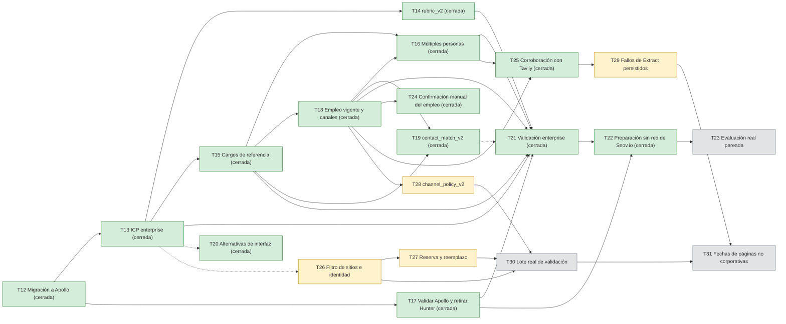

# Roadmap

Copia y guía del backlog del repositorio. La fuente de verdad son los [issues de GitHub](https://github.com/ThomasSerna/veryfi-prospecting/issues): si esta copia difiere del tracker, manda el tracker. Forma parte de la documentación de requisitos: ver el [índice](IDEA.md).

- **Fecha de corte:** 2026-11-09 (America/Bogota). Instantánea de los 31 issues: T01 a T11 cerrados entre el 2026-10-11 y el 2026-10-14, T12 y T13 cerrados el 2026-11-01, T14 cerrado el 2026-11-05, T15, T16, T18 y T20 cerrados el 2026-11-07, T17, T19, T21 y T24 cerrados el 2026-11-08, T22 y T25 cerrados el 2026-11-09, y T23 y T26 a T31 abiertos. Los [#12](https://github.com/ThomasSerna/veryfi-prospecting/pull/12), [#26](https://github.com/ThomasSerna/veryfi-prospecting/pull/26) y [#27](https://github.com/ThomasSerna/veryfi-prospecting/pull/27) son PR, no tareas.
- **Cómo actualizarla:** al abrir, editar o cerrar un issue, actualizar su fila y su copia. Los datos salen de la API pública `https://api.github.com/repos/ThomasSerna/veryfi-prospecting/issues?state=all&per_page=100`; los PR aparecen en esa lista con la clave `pull_request` y no se copian.
- **Qué es copia y qué es guía:** la tabla de estado y la sección «Copia del backlog» reproducen los issues. «Siguiente a construir», las olas, las agrupaciones por fase y las «Notas para el agente por tarea» se derivan de las dependencias del tracker y de este repositorio; no figuran en los issues.

## Estado de un vistazo

| T | Issue | Título | Estado | Prioridad | Tipo | Depende de |
|---|---|---|---|---|---|---|
| T01 | [#1](https://github.com/ThomasSerna/veryfi-prospecting/issues/1) | Definir contratos mínimos, SQLite y configuración de catálogo/rúbrica | Cerrado 2026-10-11 | — | — | ninguna |
| T02 | [#2](https://github.com/ThomasSerna/veryfi-prospecting/issues/2) | Implementar reserva/conciliación de presupuesto y cliente de proveedores | Cerrado 2026-10-11 | — | — | T01 |
| T03 | [#3](https://github.com/ThomasSerna/veryfi-prospecting/issues/3) | Integrar descubrimiento y extracción con Tavily | Cerrado 2026-10-12 | — | — | T01 y T02 |
| T04 | [#4](https://github.com/ThomasSerna/veryfi-prospecting/issues/4) | Resolver entidades, duplicados y lista de exclusiones | Cerrado 2026-10-12 | — | — | T03 |
| T05 | [#5](https://github.com/ThomasSerna/veryfi-prospecting/issues/5) | Implementar investigación con Haiku y calificación determinista | Cerrado 2026-10-12 | — | — | T01, T02, T03 y T04 |
| T06 | [#6](https://github.com/ThomasSerna/veryfi-prospecting/issues/6) | Implementar búsqueda de personas y canal directo con la ruta habilitada | Cerrado 2026-10-12 | — | — | T02 y T05 |
| T07 | [#7](https://github.com/ThomasSerna/veryfi-prospecting/issues/7) | Orquestar etapas, límites de esfuerzo, parada y recuperación | Cerrado 2026-10-12 | — | — | T02, T03, T04, T05 y T06 |
| T08 | [#8](https://github.com/ThomasSerna/veryfi-prospecting/issues/8) | Construir UI, revisión humana y CSV | Cerrado 2026-10-12 | — | — | Contratos de T01; integración funcional con T07 |
| T09 | [#9](https://github.com/ThomasSerna/veryfi-prospecting/issues/9) | Probar invariantes, validar pertinencia de contactos y ejecutar lote real pequeño | Cerrado 2026-10-13 | — | — | T07 y T08 |
| T10 | [#10](https://github.com/ThomasSerna/veryfi-prospecting/issues/10) | Incorporar revisión de Veryfi y validar la calificación con Haiku | Cerrado 2026-10-13 | — | — | T09 |
| T11 | [#11](https://github.com/ThomasSerna/veryfi-prospecting/issues/11) | Preparar entrega y condiciones del piloto | Cerrado 2026-10-14 | — | — | T09 y T10 |
| T12 | [#13](https://github.com/ThomasSerna/veryfi-prospecting/issues/13) | Migrar completamente la búsqueda y enriquecimiento de personas de Hunter a Apollo | Cerrado 2026-11-01 | P0 crítica | Migración de proveedor/backend | ninguna |
| T13 | [#14](https://github.com/ThomasSerna/veryfi-prospecting/issues/14) | Calibrar ICP enterprise y enriquecer el descubrimiento de cuentas grandes | Cerrado 2026-11-01 | P0 | Discovery/backend | T12 (migración a Apollo) |
| T14 | [#15](https://github.com/ThomasSerna/veryfi-prospecting/issues/15) | Diseñar y evaluar rubric_v2 que priorice cuentas enterprise | Cerrado 2026-11-05 | P0 | Scoring/backend | T12, T13 |
| T15 | [#16](https://github.com/ThomasSerna/veryfi-prospecting/issues/16) | Configurar cargos de referencia de Veryfi para búsqueda en Apollo | Cerrado 2026-11-07 | P0 | Reglas de negocio/búsqueda | T12, T13 |
| T16 | [#17](https://github.com/ThomasSerna/veryfi-prospecting/issues/17) | Buscar múltiples personas relevantes por cuenta usando Apollo | Cerrado 2026-11-07 | P0 | Pipeline/backend | T12, T15, T18 |
| T17 | [#18](https://github.com/ThomasSerna/veryfi-prospecting/issues/18) | Validar costos, acceso, confiabilidad y limpieza de la migración a Apollo | Cerrado 2026-11-08 | P0 | QA/operación de proveedor único | T12 |
| T18 | [#19](https://github.com/ThomasSerna/veryfi-prospecting/issues/19) | Verificar empleo vigente y canales profesionales de contactos Apollo | Cerrado 2026-11-07 | P0 | Calidad de datos/backend | T12, T15 |
| T19 | [#20](https://github.com/ThomasSerna/veryfi-prospecting/issues/20) | Versionar contact_match_v2 y priorizar personas obtenidas con Apollo | Cerrado 2026-11-08 | P1 | Ranking/backend | T15, T18 |
| T20 | [#21](https://github.com/ThomasSerna/veryfi-prospecting/issues/21) | Evaluar tres alternativas de interfaz para cuentas enterprise y contactos Apollo | Cerrado 2026-11-07 | P1 (paralelizable) | Evaluación UX/UI | T12 para definir estados de Apollo, T13 para escenarios enterprise |
| T21 | [#22](https://github.com/ThomasSerna/veryfi-prospecting/issues/22) | Validar el pipeline enterprise con Apollo frente a la línea base Hunter | Cerrado 2026-11-08 | P0 para cierre, ejecutar al final | QA/evaluación | T12, T13, T14, T15, T16, T17, T18 (T19 si aplica) |
| T22 | [#23](https://github.com/ThomasSerna/veryfi-prospecting/issues/23) | [SPIKE no funcional] Preparar comparación Snov.io vs Apollo sin llamadas reales | Cerrado 2026-11-09 | P2 | Spike técnico/no funcional | T12, T16, T17, T18 y antecedentes técnicos de T21 |
| T23 | [#28](https://github.com/ThomasSerna/veryfi-prospecting/issues/28) | [SPIKE no funcional] Evaluar Snov.io frente a Apollo con una muestra real pareada | Abierto | P2 | Spike técnico/no funcional | T22, T12, T16, T17, T18 y antecedentes técnicos de T21 |
| T24 | [#24](https://github.com/ThomasSerna/veryfi-prospecting/issues/24) | Permitir que ventas confirme manualmente el empleo vigente de una persona | Cerrado 2026-11-08 | P1 | Revisión humana/backend e interfaz | T18 |
| T25 | [#25](https://github.com/ThomasSerna/veryfi-prospecting/issues/25) | Corroborar con Tavily el empleo de personas de Apollo sin evidencia corporativa | Cerrado 2026-11-09 | P1 | Pipeline/backend | T18, T16 (política de esfuerzo) |
| T26 | [#30](https://github.com/ThomasSerna/veryfi-prospecting/issues/30) | Filtrar sitios no empresariales y orientar la confirmación de identidad | Abierto | P0 | Discovery/backend | ninguna (T13 como antecedente) |
| T27 | [#31](https://github.com/ThomasSerna/veryfi-prospecting/issues/31) | Reservar y reemplazar las empresas que no confirman su identidad | Abierto | P0 | Discovery/pipeline | T26 |
| T28 | [#32](https://github.com/ThomasSerna/veryfi-prospecting/issues/32) | Aceptar correos verificados por Apollo con una política de canal versionada | Abierto | P0 | Reglas de negocio/contactos | T18 |
| T29 | [#33](https://github.com/ThomasSerna/veryfi-prospecting/issues/33) | Persistir los motivos de fallo de Tavily Extract | Abierto | P2 | Persistencia/observabilidad | T25 |
| T30 | [#34](https://github.com/ThomasSerna/veryfi-prospecting/issues/34) | Validar con un lote real las políticas nuevas de descubrimiento y canal | Abierto | P1 | QA/evaluación | T26, T27 y T28 |
| T31 | [#35](https://github.com/ThomasSerna/veryfi-prospecting/issues/35) | [SPIKE no funcional] Evaluar fechas citadas en páginas no corporativas para corroborar el empleo | Abierto | P3 | Spike técnico/no funcional | T29 y T30 |

Las prioridades y los tipos solo existen en los issues T12 a T31. Los criterios de aceptación de cada tarea están en su issue. Los números de issue son permanentes y comparten secuencia con los PR; el identificador T es una etiqueta del backlog.

**Identificadores históricos:** la confirmación manual de empleo es T24 ([#24](https://github.com/ThomasSerna/veryfi-prospecting/issues/24)), llamada T23 cuando se implementó; la corroboración dirigida es T25 ([#25](https://github.com/ThomasSerna/veryfi-prospecting/issues/25)), llamada T24 cuando se implementó. Las referencias históricas en documentos, código, enlaces y configuraciones conservan esos nombres originales. La nueva T23 es la evaluación Snov frente a Apollo ([#28](https://github.com/ThomasSerna/veryfi-prospecting/issues/28)).

## Siguiente a construir

Derivado de las dependencias y prioridades del tracker. Con T12 a T22, T24 y T25 cerradas:

| Situación | Tareas | Motivo |
|---|---|---|
| Lista para construir | T26 (P0) | Los lotes reales de T17 y T24 perdieron 4 de 5 empresas por identidad sin confirmar |
| Lista para construir | T28 (P0) | Texto de la regla aprobado el 2026-11-09; paralela a T26 y T27 |
| Lista para construir | T29 (P2) | Independiente; conserva el diagnóstico de los fallos de Extract |
| Tras T26 | T27 (P0) | Reemplaza las empresas que T26 aún no logre confirmar |
| Tras T26, T27 y T28 | T30 (P1) | Requiere autorización de gasto de cada proveedor |
| Tras T29 y T30 | T31 (P3) | Mide sobre los resultados persistidos del lote |
| Preparación técnica lista; evaluación pendiente | T23 (P2) | Fuera del plan actual; faltan la muestra real, el acceso, los precios y la autorización de cada proveedor |

El cierre técnico de T21 no acredita una línea base real pareada para T23.

## Dependencias entre tareas

Verde: cerrada. Amarillo: abierta y lista para construir. Gris: pendiente de muestra, acceso, autorización o de tareas previas. La línea punteada marca una dependencia parcial (T20 usa los escenarios de T13 y T21 incluye T19 solo si aplica). T23 depende de T12, T16, T17 y T18, ya cerradas; se omiten las aristas transitivas. T21 aporta antecedentes técnicos, no una línea base real pareada.

## Copia del backlog

Agrupación de lectura derivada de las prioridades y dependencias; el tracker no define fases. Cada issue conserva su texto; las casillas de los criterios de aceptación se muestran como viñetas y su estado vive en el issue.

### Conversión de lotes reales (T26 a T31 abiertas)

Los lotes reales de T09, T11, T17 y T24 terminaron con 0 personas listas. Estas tareas atacan los dos frenos observados (empresas perdidas por identidad y correos de Apollo sin fecha de verificación) y conservan el diagnóstico.

#### T26 · Filtrar sitios no empresariales y orientar la confirmación de identidad

- **Issue:** [#30](https://github.com/ThomasSerna/veryfi-prospecting/issues/30)
- **Estado:** Abierto
- **Prioridad:** P0
- **Dependencias:** ninguna (T13 como antecedente)
- **Tipo:** Discovery/backend

**Historia de usuario**

Como responsable comercial, quiero que el descubrimiento descarte portales, directorios y bolsas de empleo, y que la confirmación de identidad lea primero las páginas que nombran a la empresa, para que más cuentas lleguen a la etapa de contactos.

**Contexto**

En los lotes reales de T17 y T24, 4 de cada 5 empresas se detuvieron por `name_unconfirmed`, `country_unconfirmed` o `identity_unverified` antes de buscar contactos. Las paradas guardadas muestran portales de contenido y empleo (`softwaredoit.es`, `gestiopolis.com`, `tecoloco.com`), subdominios de blog (`blog.cool-tabs.com`), dominios de otro país (`.es`, `.com.pe`) y micrositios sin texto legible. El único filtro de sitios no empresariales es una tupla fija (`prospecting/sources.py`); `initial_urls` (`prospecting/discovery.py`) pone la portada detrás del tope de 3 páginas, y Tavily Extract usa `extract_query(campaign)`, orientada a señales de producto y no al nombre ni al país.

**Alcance**

- Versionar el cambio como `discovery_policy_v2` en `VeryfiConfig`; sin ella, las consultas, payloads y huellas actuales no cambian.
- Descartar localmente, después de la búsqueda y con el motivo `non_business_site`, los hosts de una lista versionada de portales, directorios, bolsas de empleo y marketplaces, y los subdominios de contenido (`blog.`, `noticias.`…). No modificar `NON_BUSINESS_DOMAINS`, que viaja en el payload persistido.
- Posponer en la selección, sin excluir, los dominios con sufijo de un país ajeno a la campaña: según `docs/Business-rules.md`, un ccTLD extranjero solo añade una advertencia. Los sufijos de uso genérico (`.co`, `.io`, `.ai`…) no cuentan como país.
- Con v2, leer primero la portada y las páginas propias de «nosotros» o «contacto», dentro del mismo tope de páginas.
- Con v2, reordenar los fragmentos de Extract con el nombre inferido, «quiénes somos», «contacto» y los países, seguidos de las señales de los perfiles.
- Documentar en `docs/discovery.md` y fijar la versión y el motivo nuevo en `docs/persistence.md`.

**Criterios de aceptación**

- Un portal, una bolsa de empleo y un subdominio de blog sintéticos no se convierten en candidatas; el descarte queda contado con su motivo.
- Un dominio de otro país solo ocupa plaza cuando faltan candidatas locales en su combinación.
- Con v2, la portada entra en las páginas iniciales aunque haya 3 o más resultados del dominio, y Extract recibe la consulta de identidad.
- El payload enviado a Tavily Search es idéntico con o sin v2, y una campaña sin v2 conserva su conducta (`tests/test_persisted_identifiers.py`).
- Pruebas sin red; sin proveedores nuevos ni llamadas de pago adicionales.

#### T27 · Reservar y reemplazar las empresas que no confirman su identidad

- **Issue:** [#31](https://github.com/ThomasSerna/veryfi-prospecting/issues/31)
- **Estado:** Abierto
- **Prioridad:** P0
- **Dependencias:** T26
- **Tipo:** Discovery/pipeline

**Historia de usuario**

Como responsable comercial, quiero que una empresa que no supera la confirmación de identidad sea sustituida por la siguiente candidata, para que cada campaña termine con el número de cuentas pedido cuando el presupuesto lo permite.

**Contexto**

`select_candidates` (`prospecting/discovery.py`) toma exactamente `max_companies`. Las candidatas restantes solo existen en el informe en memoria; cuando una empresa cae por identidad, nada la reemplaza y el descubrimiento no se repite (`already_discovered`).

**Alcance**

- Con `discovery_policy_v2`, conservar hasta `max_companies` candidatas de reserva con la misma prioridad de selección y persistirlas como candidatas en espera, con una migración de esquema como la de `profile_matches`.
- Cuando una empresa termina en `name_unconfirmed`, `country_unconfirmed`, `identity_unverified` o `domain_unknown`, promover la siguiente reserva de su combinación país/segmento.
- Reservar gasto antes de cada llamada de la reserva promovida (solo en `prospecting/pipeline/calls.py`) y respetar los topes de búsqueda y Extract de la campaña.
- Añadir el motivo de parada `reserve_exhausted`, visible en la interfaz.
- Documentar en `docs/discovery.md`, `docs/campaign.md` y `docs/persistence.md`.

**Criterios de aceptación**

- Una empresa caída por identidad se reemplaza por la reserva siguiente sin superar el presupuesto.
- Reanudar tras una interrupción no promueve dos veces la misma reserva.
- Con las reservas agotadas, la campaña termina con `reserve_exhausted`.
- Las campañas sin v2 no cambian; pruebas sin red y prueba de la migración del esquema.
- Los identificadores persistidos nuevos se documentan en `docs/persistence.md` y se fijan en `tests/test_persisted_identifiers.py`.

#### T28 · Aceptar correos verificados por Apollo con una política de canal versionada

- **Issue:** [#32](https://github.com/ThomasSerna/veryfi-prospecting/issues/32)
- **Estado:** Abierto
- **Prioridad:** P0
- **Dependencias:** T18
- **Tipo:** Reglas de negocio/contactos

**Historia de usuario**

Como responsable comercial, quiero que un correo profesional que Apollo informa como verificado pueda dejar lista a una persona con empleo vigente comprobado, para no depender siempre de una confirmación manual del canal.

**Contexto**

La regla exige una verificación del correo de hasta 30 días («Frescura» en `docs/Business-rules.md`). Apollo informa `email_status`, pero no la fecha de verificación: el adaptador (`prospecting/providers/apollo.py`) convierte `verified` en `unknown`, y `channel_is_usable` (`prospecting/contacts.py`) nunca acepta el correo. Aun con el empleo corroborado, la persona queda en «necesita confirmar canal».

**Alcance**

- Actualizar `docs/Business-rules.md` y `docs/contacts.md` con el texto aprobado por el usuario el 2026-11-09: con `channel_policy_v2`, un correo nominal del dominio confirmado que Apollo informa con `email_status=verified` cuenta como verificado por el proveedor durante 30 días desde la consulta (`retrieved_at`), porque Apollo no informa una fecha de verificación propia.
- Versionar el cambio como `channel_policy_v2`; las instantáneas sin ella conservan la conducta actual.
- Añadir el estado normalizado `provider_verified`, distinto de `verified` (que exige `verified_at`), y conservar `provider_status`.
- Mostrar en la ficha y el CSV «Verificado por Apollo (sin fecha de verificación propia)».
- Mantener la conducta de `catch_all`, `unknown` e `invalid`; la identidad, el cargo pertinente y el empleo vigente siguen siendo obligatorios para listo.
- Fijar los identificadores nuevos en `docs/persistence.md`.

**Criterios de aceptación**

- Sin v2, el correo de Apollo sigue pendiente, como hoy.
- Con v2, un correo verificado consultado hace 30 días o menos queda utilizable; con más de 30 días, vencido.
- `invalid` sigue bloqueando el canal y una confirmación manual no lo borra.
- La ficha y el CSV distinguen el correo verificado por Apollo de uno con fecha de verificación propia.
- Pruebas sin red; los identificadores persistidos nuevos se fijan en `tests/test_persisted_identifiers.py`; sin envío de mensajes.

#### T29 · Persistir los motivos de fallo de Tavily Extract

- **Issue:** [#33](https://github.com/ThomasSerna/veryfi-prospecting/issues/33)
- **Estado:** Abierto
- **Prioridad:** P2
- **Dependencias:** T25
- **Tipo:** Persistencia/observabilidad

**Historia de usuario**

Como equipo técnico, queremos conservar el motivo por el que Tavily Extract no devolvió contenido de una URL, para diagnosticar después por qué no se confirmó una empresa o no se corroboró una persona.

**Contexto**

En el lote real de T24, la extracción de 3 URL no devolvió texto. El motivo literal solo quedó en los avisos de la ejecución (`prospecting/pipeline/contacts.py`), que el pipeline descarta. La investigación de empresas (`prospecting/pipeline/research.py`) tampoco persiste sus `failed_urls`.

**Alcance**

- Guardar cada fallo en `RunItem.attempts`, sin cambios de esquema, con las claves `contacts:extract_failed:<url> <motivo>` y `research:extract_failed:<url> <motivo>` y valor 1: `attempts` solo admite contadores, así que la URL y el motivo recortado van en la clave.
- Mostrar los fallos en la ficha de la empresa y su conteo en `manage.py corroboration_report`.
- Documentar las claves en `docs/persistence.md`.

**Criterios de aceptación**

- Un fallo sintético de Extract queda persistido, visible en la ficha y contado en el informe.
- Un fallo no crea evidencia.
- Reanudar no duplica el registro.
- Las claves nuevas se fijan en `tests/test_persisted_identifiers.py`.

#### T30 · Validar con un lote real las políticas nuevas de descubrimiento y canal

- **Issue:** [#34](https://github.com/ThomasSerna/veryfi-prospecting/issues/34)
- **Estado:** Abierto
- **Prioridad:** P1
- **Dependencias:** T26, T27 y T28
- **Tipo:** QA/evaluación

**Historia de usuario**

Como responsable comercial, quiero un lote real pequeño con las políticas nuevas de descubrimiento y canal, para medir si el pipeline deja personas listas con datos reales.

**Dependencias y condiciones previas**

- Depende de T26, T27 y T28 cerradas en `main`.
- Antes de cualquier llamada, obtener autorización explícita del responsable de cada cupo para proveedor, operación y tope de esa sesión, y copiar la base en `data/backups/`. Si falta alguna condición, registrar el bloqueo y no realizar llamadas.

**Alcance**

- Ejecutar un lote equivalente al de T24: Colombia y México, `fintech_software` y `cpg_loyalty`, máximo 5 empresas, con `discovery_policy_v2` y `channel_policy_v2`.
- Medir empresas que confirman identidad (antes, 1 de 5), reservas usadas, personas pertinentes, personas listas y costo por persona lista. Con denominador cero, declarar el costo no calculable.
- Conciliar Tavily, Apollo y Haiku como en T24 y registrar el resultado en `docs/provider-check.md`.
- Mantener contactos reales solo en `data/`, fuera de Git, fixtures, logs y capturas.

**Criterios de aceptación**

- Los resultados reales se separan de los simulados, con numeradores, denominadores, fechas y costos.
- Toda solicitud queda conciliada o con su motivo pendiente.
- La comparación con el lote de T24 identifica qué cambio aportó cada mejora y qué sigue bloqueando.
- Sin envío de mensajes, llamadas ni invitaciones.

#### T31 · [SPIKE no funcional] Evaluar fechas citadas en páginas no corporativas para corroborar el empleo

- **Issue:** [#35](https://github.com/ThomasSerna/veryfi-prospecting/issues/35)
- **Estado:** Abierto
- **Prioridad:** P3
- **Dependencias:** T29 y T30
- **Tipo:** Spike técnico/no funcional

**Historia de usuario no funcional**

Como equipo técnico, queremos saber cuántas páginas no corporativas sin fecha contienen una fecha citada utilizable, para decidir si vale la pena extraerla y reducir las revisiones humanas por `undated_source`.

**Dependencias y condiciones previas**

- Depende de los fallos persistidos de T29 y de los resultados del lote real de T30.
- No requiere llamadas nuevas: trabaja sobre la evidencia ya guardada.

**Alcance de la evaluación**

- `employment_freshness` (`prospecting/contacts.py`) marca como `undated` toda página no corporativa sin fecha; Tavily (`topic=general`) no devuelve fecha de publicación y Haiku ya admite fechas citadas (`quoted_date`).
- Contar cuántas fuentes `undated_source` traen una fecha citada atribuible a la persona y a la empresa.
- Recomendar si conviene implementar la extracción. Cualquier cambio a las reglas de vigencia exige una decisión autorizada y una historia separada.

**Criterios de aceptación**

- El informe documenta muestra, numeradores, denominadores y limitaciones.
- Se distinguen resultados reales de fixtures.
- No hay cambios de reglas ni de código de producción.

### Enterprise sobre Apollo (T13 a T21 cerradas)

#### T13 · Calibrar ICP enterprise y enriquecer el descubrimiento de cuentas grandes

- **Issue:** [#14](https://github.com/ThomasSerna/veryfi-prospecting/issues/14)
- **Estado:** Cerrado
- **Prioridad:** P0
- **Dependencias:** T12 (migración a Apollo)
- **Tipo:** Discovery/backend

**Historia de usuario**

Como responsable comercial de Veryfi, quiero descubrir y clasificar empresas grandes comparables a las de referencia y respaldar sus características con fuentes, para concentrar el esfuerzo en cuentas de verdadero encaje.

**Alcance**

- Obtener y registrar los ejemplos de empresas grandes y perfiles/cargos que facilitó Veryfi; documentar etiquetas positivas/negativas por segmento, autorización de uso y estado de validación.
- Distinguir empresa matriz, marcas, filiales, país, ingresos públicos, empleados, cobertura geográfica y caso de uso documental. Separar clientes actuales/exclusiones de cuentas candidatas.
- Adecuar consultas de Tavily para descubrir cuentas enterprise en Colombia/México; enriquecer con Apollo Organization Search/Enrichment solo si se justifica, se comprueba acceso y se autoriza consumo. No añadir otra API de empresas o personas.
- Conservar el valor original de cada dato de tamaño, fecha, fuente y estado `unknown`; no afirmar ingresos o número de empleados sin evidencia.
- Usar `How Veryfi Sells` (tiers e ICP) como antecedente histórico pendiente de ratificación comercial; reservar muestra etiquetada independiente antes de ajustar pesos.

**Criterios de aceptación**

- ICP y ejemplos de referencia versionados, con procedencia y validación de Veryfi o estado explícito pendiente.
- Señales de escala con fuente y ámbito (grupo, filial, país), sin estimaciones inventadas.
- Búsqueda favorece cuentas grandes sin sacrificar necesidad documental ni exclusiones.
- La comparación de descubrimiento anterior/nuevo es reproducible y no requiere proveedor adicional a Tavily/Apollo.
- Pruebas con entidades de múltiples marcas/filiales, tamaños desconocidos y cuentas sin encaje.

#### T14 · Diseñar y evaluar rubric_v2 que priorice cuentas enterprise

- **Issue:** [#15](https://github.com/ThomasSerna/veryfi-prospecting/issues/15)
- **Estado:** Cerrado
- **Prioridad:** P0
- **Dependencias:** T12, T13
- **Tipo:** Scoring/backend

**Historia de usuario**

Como ejecutivo de ventas, quiero una calificación explicable que priorice empresas de gran tamaño sin confundir tamaño con intención de compra, para revisar primero las oportunidades empresariales con casos de uso adecuados.

**Alcance**

- Crear una `rubric_v2` versionada, manteniendo `rubric_v1` para las campañas históricas.
- Evaluar como **hipótesis** los pesos necesidad 30, oferta 20, escala 35, adopción 10 y oportunidad 5; contrastarlos con la rúbrica anterior 35/25/20/10/10 y ejemplos de Veryfi.
- Incorporar señales de escala de T13; conservar requisitos mínimos de necesidad documental, compatibilidad con la oferta, calidad de evidencia y `coverage`.
- La puntuación mide encaje observable, no probabilidad de compra.
- Comparar resultados offline sin gastar APIs; ajustar pesos solo con decisiones documentadas.

**Criterios de aceptación**

- Pesos suman 100 y `null` no equivale a 0.
- `rubric_v1` y los resultados anteriores se pueden reproducir sin alteración.
- Un gran conglomerado sin caso de uso sustentado no recibe prioridad alta por tamaño solamente.
- Reporte con cambios en ranking, falsos positivos y casos por segmento.
- Pruebas unitarias de criterios, umbrales y compatibilidad con Apollo como proveedor de personas.

#### T15 · Configurar cargos de referencia de Veryfi para búsqueda en Apollo

- **Issue:** [#16](https://github.com/ThomasSerna/veryfi-prospecting/issues/16)
- **Estado:** Cerrado 2026-11-07
- **Prioridad:** P0
- **Dependencias:** T12, T13
- **Tipo:** Reglas de negocio/búsqueda

**Historia de usuario**

Como representante comercial, quiero que Apollo busque cargos y funciones semejantes a las personas que permitieron a Veryfi abrir oportunidades, para encontrar diferentes promotores y decisores potenciales de las empresas enterprise.

**Alcance**

- Convertir ejemplos de cargos proporcionados por Veryfi en taxonomía versionada por vertical/caso de uso; no publicar perfiles nominativos sin autorización.
- Normalizar equivalencias ES/EN, departamento, seniority y variantes; separar promotor de negocio, promotor técnico y comprador económico sin deducir capacidad de compra exclusivamente del título.
- Mapear `target_roles` a `person_titles[]`, `person_seniorities[]` y filtros apropiados de Apollo; evitar combinaciones que amplían excesivamente la búsqueda.
- Definir criterios para excluir funciones no relevantes y para seleccionar cobertura diversa de roles, conservando títulos originales y procedencia.
- La extracción pública con Tavily/Haiku permanece como ayuda para evidencia, **no como otra fuente pagada de contactos**.

**Criterios de aceptación**

- Catálogo de cargos versionado y trazable a ejemplos reales o su estado de pendiente de validación.
- Pruebas de títulos ES/EN, variantes, jerarquías ambiguas, roles fuera del perfil y personas regionales.
- Los filtros de Apollo pueden generarse desde el catálogo sin editar código de negocio.
- Los cargos devueltos se validan por función antes de considerarse contactos pertinentes.
- Sin datos personales privados en repositorio, fixtures ni logs.

#### T16 · Buscar múltiples personas relevantes por cuenta usando Apollo

- **Issue:** [#17](https://github.com/ThomasSerna/veryfi-prospecting/issues/17)
- **Estado:** Cerrado 2026-11-07
- **Prioridad:** P0
- **Dependencias:** T12, T15, T18
- **Tipo:** Pipeline/backend

**Historia de usuario**

Como ejecutivo de ventas, quiero identificar varias personas de distintas funciones en cada cuenta enterprise, para contar con opciones reales sin detener el análisis en el primer correo válido.

**Alcance**

- Reemplazar el stop temprano en `READY_PREFERRED` por política versionada de objetivo de personas, diversidad de funciones y límites de costo, tiempo y créditos.
- Usar **solo Apollo** para búsqueda y enriquecimiento estructurado de personas, con consultas por dominios confirmados, cargo, departamento y seniority configurados en T15.
- Objetivo experimental de 3–5 personas pertinentes por cuenta enterprise, con al menos dos funciones cuando haya resultados; no garantizar esa cantidad.
- Separar candidatos, identidades verificadas, personas pertinentes, canales utilizables y personas listas. El resultado de People Search sin correo completo no consume cupo de 'listo'.
- Priorizar enriquecimientos por pertinencia y diversidad; no enriquecer indiscriminadamente a toda la organización.
- Mantener idempotencia, checkpoints, reanudación y explicaciones de topes/ausencias.

**Criterios de aceptación**

- Encontrar un primer canal utilizable no termina la cuenta antes de objetivo o límite explícito.
- Pruebas con 0, 1, 3, 5+ personas, duplicados, ausencias de email y cambios de cargo.
- Se guardan todas las personas observadas con procedencia, incluidas las no contactables; no se fabrican apellidos ofuscados.
- No se salta el presupuesto ni los límites de Apollo al paginar/enriquecer.
- La UI y el CSV distinguen candidatos, personas pertinentes y contactos listos.

#### T17 · Validar costos, acceso, confiabilidad y limpieza de la migración a Apollo

- **Issue:** [#18](https://github.com/ThomasSerna/veryfi-prospecting/issues/18)
- **Estado:** Cerrado 2026-11-08
- **Prioridad:** P0
- **Dependencias:** T12
- **Tipo:** QA/operación de proveedor único

**Historia de usuario**

Como responsable técnico del proyecto, quiero comprobar la operación y costos de Apollo como proveedor único de personas y cerrar todos los rastros operativos de Hunter, para que el proyecto sea funcional, reproducible y no genere gastos inesperados.

**Alcance**

- Verificar manualmente acceso real de cuenta Apollo a Search y Enrichment, autorización, permisos y créditos disponibles antes de llamadas; documentación oficial y resultados del panel.
- Confirmar que People Search puede omitir apellido completo y correo; que enriquecimiento tiene costo variable y que búsquedas empresariales pueden tener créditos distintos.
- Consolidar una única cuota/autorización del proveedor de personas Apollo, separada de Tavily y Haiku, con reservas conservadoras, conciliación, límites de tasa, timeout, 401/403/422/429, errores parciales y reanudación segura.
- Auditoría de `HUNTER_API_KEY`, operaciones `hunter:*`, pantallas, parámetros, docstrings, documentación y tests activos; retirar cualquier dependencia runtime. **No borrar registros históricos ni sus fuentes.**
- Ejecutar suite sintética sin red y un lote real pequeño solo con autorización explícita y cupo confirmado. Verificar que demo offline funcione.
- Preparar guía de puesta en marcha y de limitaciones de la cuenta, sin añadir proveedores alternativos.

**Criterios de aceptación**

- En ningún flujo nuevo hay llamadas a Hunter; la configuración operativa exige solo Apollo para personas.
- Falta de permisos/créditos produce pendiente con motivo, sin cambiar de proveedor ni gastar fuera de cupos.
- Ledger, crédito disponible y costo conciliado de Apollo verificables; claves fuera del repositorio.
- Pruebas de límites, llamadas repetidas, concurrencia local, caídas y fallos del proveedor.
- Evidencia de prueba real o bloqueo documentado; no se afirma que la migración es funcional en vivo sin resultados.
- Documentación actualizada y demo sin credenciales sigue siendo reproducible.

#### T18 · Verificar empleo vigente y canales profesionales de contactos Apollo

- **Issue:** [#19](https://github.com/ThomasSerna/veryfi-prospecting/issues/19)
- **Estado:** Cerrado 2026-11-07
- **Prioridad:** P0
- **Dependencias:** T12, T15
- **Tipo:** Calidad de datos/backend

**Historia de usuario**

Como responsable comercial, quiero distinguir las personas halladas por Apollo de las que realmente ejercen el cargo y tienen un canal profesional utilizable, para evitar prospectos obsoletos.

**Alcance**

- Separar datos declarados por Apollo (cargo, organización, actualización, email) de evidencia externa de empleo vigente.
- Reutilizar páginas corporativas y directorios públicos localizados mediante el Tavily ya integrado, sin introducir otro proveedor de personas.
- Sustituir la señal `hunter_signal` en reglas activas por estados neutrales a proveedor: `provider_claim`, `corporate_evidence`, `contradicted`, `unknown` (o equivalentes bien documentados). Mantener el origen histórico Hunter sin reinterpretarlo.
- Mantener canal verificado, contacto profesional, procedencia y fechas; no asumir que tener email significa seguir empleado ni que 'last_refreshed_at' valida cargo.
- Evitar que una persona no verificable aparezca como 'lista'; revisión humana explícita para casos ambiguos.

**Criterios de aceptación**

- Un email devuelto por Apollo sin evidencia laboral suficiente no se presenta como empleo confirmado.
- Contradicciones y fuentes caducadas bloquean la categoría 'listo' con motivo.
- Fuentes corporativas vigentes permiten justificar empleo sin enviar mensajes.
- Pruebas con cambio de cargo, salida laboral, ambigüedad y apellidos ofuscados.
- Datos históricos de Hunter quedan interpretables sin volver a llamar a ese proveedor.

#### T19 · Versionar contact_match_v2 y priorizar personas obtenidas con Apollo

- **Issue:** [#20](https://github.com/ThomasSerna/veryfi-prospecting/issues/20)
- **Estado:** Cerrado 2026-11-08
- **Prioridad:** P1
- **Dependencias:** T15, T18
- **Tipo:** Ranking/backend

**Historia de usuario**

Como analista comercial, quiero ordenar las personas por pertinencia, empleo vigente y canales de comunicación, para que los resultados multicontacto de Apollo sean útiles para ventas.

**Alcance**

- Conservar el `contact_match_v1` histórico (rol 50, canal 25, identidad 15, empleo 10).
- Evaluar propuesta `contact_match_v2` (rol 40, canal 20, identidad 15, empleo 25), **no validada** y sujeta a casos reales compartidos por Veryfi.
- No incluir el proveedor en el peso comercial, ni asumir correo o empleo válido solo por aparecer en Apollo.
- Mostrar puntuación desglosada, fuente, vigencia, estado de contactabilidad y diversidad de funciones.
- Mantener la regla de elegibilidad/listo separada del score, y preservar comparabilidad offline.

**Criterios de aceptación**

- Pesos=100, valores y fuentes validados; nueva versión JSON, sin defaults silenciosos.
- Histórico v1 se reproduce al consultar antiguas campañas.
- Casos con seniority muy alto pero función irrelevante no dominan el ranking.
- Match alto no convierte en listo un contacto no verificado.
- Pruebas de ranking estable, diversidad, cargos bilingües y empleo contradictorio.

#### T20 · Evaluar tres alternativas de interfaz para cuentas enterprise y contactos Apollo

- **Issue:** [#21](https://github.com/ThomasSerna/veryfi-prospecting/issues/21)
- **Estado:** Cerrado 2026-11-07
- **Prioridad:** P1 (paralelizable)
- **Dependencias:** T12 para definir estados de Apollo, T13 para escenarios enterprise
- **Tipo:** Evaluación UX/UI

**Historia de usuario**

Como usuario comercial de Veryfi, quiero evaluar distintas interfaces para revisar grandes cuentas y varias personas obtenidas con Apollo, para elegir el diseño más claro antes de reformar la interfaz.

**Alcance exclusivamente UX/UI — sin implementación del pipeline**

- Auditar el recorrido Django actual (campaña, cuenta, personas, evidencia y revisión) y las necesidades de mostrar cuota de Apollo, estado de enriquecimiento y diferencia entre persona encontrada/lista.
- Proponer **al menos tres alternativas** comparables: tabla con detalle por cuenta, maestro-detalle y tablero por estado (u otras justificadas).
- Diseñar prototipos/wireframes sin editar reglas de negocio, proveedor, backend ni consumo.
- Evaluar tareas con usuarios representativos (idealmente 3–5, describiendo limitaciones), navegación en escritorio/móvil, accesibilidad, tiempos de búsqueda de información y errores.
- Entregar matriz de decisión y recomendación; la implementación posterior de la alternativa elegida deberá planificarse por separado.
- Mostrar siempre procedencia, contacto válido vs pendiente y costo/consumo sin confundir un dato de Apollo con confirmación comercial.

**Criterios de aceptación**

- Tres alternativas visuales, mismas tareas, criterios comparables.
- Evaluación documentada y diseño seleccionado con justificación.
- Distingue personas candidatas, pertinentes y listas, estado de enriquecimiento, cuota y evidencia.
- No hay llamadas a APIs, cambios de scoring ni rediseño de backend en esta historia.
- Compatible con identidad visual Veryfi y accesibilidad básica.

#### T21 · Validar el pipeline enterprise con Apollo frente a la línea base Hunter

- **Issue:** [#22](https://github.com/ThomasSerna/veryfi-prospecting/issues/22)
- **Estado:** Cerrado 2026-11-08
- **Prioridad:** P0 para cierre, ejecutar al final
- **Dependencias:** T12, T13, T14, T15, T16, T17, T18 (T19 si aplica)
- **Tipo:** QA/evaluación

**Historia de usuario**

Como equipo de producto, quiero comparar el nuevo sistema Apollo + puntuación enterprise + multicontacto con la línea base histórica de Hunter, para demostrar qué mejoras funcionan y cuánto cuestan.

**Alcance**

- Reservar muestra independiente por segmento, tamaño y país, con cuentas y roles compartidos por Veryfi cuando estén disponibles.
- Utilizar el replay offline y las evidencias guardadas. Las llamadas nuevas a Apollo/Tavily/Haiku requieren cupos verificados y autorización explícita.
- Línea base disponible: T09/T11, 24 selecciones documentadas y 0 contactos listos; señalar diferencias de muestra/flujo y no extrapolar a toda LATAM.
- Medir empresas enterprise aceptadas, contactos relevantes y utilizables por empresa, diversidad de funciones, empleo verificado, tiempo, créditos y costo por contacto útil.
- Comparar `rubric_v1/v2` y `contact_match_v1/v2` si procede. No se hacen nuevas llamadas a Hunter: son datos históricos.
- Concluir cobertura, restricciones operativas y estado de validación comercial, sin confundir tests sintéticos con resultados reales.

**Criterios de aceptación**

- Informe reproducible con denominadores, origen, fechas, límites y costos de Apollo.
- Se distingue cobertura de personas de porcentaje de correos utilizables y de empresas validadas comercialmente.
- Comparación antes/después declara qué cambios simultáneos impiden inferencia causal.
- Se reportan errores, duplicados, puestos obsoletos y empresas grandes sin encaje.
- El pipeline principal no introduce Snov ni otros proveedores de contactos.

### Seguimiento de T18 (T24 y T25 cerradas)

#### T24 · Permitir que ventas confirme manualmente el empleo vigente de una persona

- **Issue:** [#24](https://github.com/ThomasSerna/veryfi-prospecting/issues/24)
- **Estado:** Cerrado 2026-11-08
- **Prioridad:** P1
- **Dependencias:** T18
- **Tipo:** Revisión humana/backend e interfaz

**Historia de usuario**

Como representante comercial, quiero registrar que comprobé el empleo vigente de una persona marcada para revisión, para resolver un caso ambiguo sin esperar a que aparezca una nueva fuente corporativa.

**Alcance**

- Añadir en la ficha una acción de confirmación del empleo, análoga a `confirm_alternative_channel` (`prospecting/pipeline/contacts.py`), solo para personas cuyo `employment_status` sea `provider_claim` o tenga `review_required` (`title_changed`, `undated_source`, `ambiguous_source`, `title_unconfirmed`, `historical_inference`).
- Guardar una evidencia `manual` observada con motivo, fecha y la fuente consultada por el vendedor; conservar las fuentes originales, las contradicciones y los datos del proveedor sin reescribirlos.
- En `title_changed`, la confirmación indica cuál de los cargos ya citados es el vigente; no se acepta un cargo nuevo sin fuente.
- La confirmación vence según `cache.contact_days` y una contradicción posterior (salida nominal, otra entidad) la anula.
- Decidir con aprobación si la confirmación manual cuenta como `corporate_evidence` o como un estado propio, y si habilita 'listo'. Actualizar «Vigencia del empleo» en `docs/Business-rules.md`.
- Guardar contacto, evidencia y disponibilidad recalculada en una sola transacción; bloquear durante una ejecución y en campañas históricas.
- No enviar mensajes, hacer llamadas ni mandar invitaciones para comprobar el empleo.
- La ficha y el CSV muestran el origen manual, el motivo y la fecha.

**Criterios de aceptación**

- Una persona con `contradicted`/`employment_ended` no se puede confirmar.
- Se rechaza una confirmación sin motivo o sin aceptación explícita.
- La confirmación caduca y la persona vuelve a su estado anterior; una contradicción posterior la anula.
- Pruebas de rollback, caducidad, contradicción posterior, cambio de cargo y campaña histórica.
- Los identificadores persistidos nuevos (referencia de la evidencia manual) se documentan en `docs/persistence.md` y se fijan en `tests/test_persisted_identifiers.py`.

**Identificador histórico:** esta tarea se denominó T23 al implementarse; su número de issue permanece #24.

#### T25 · Corroborar con Tavily el empleo de personas de Apollo sin evidencia corporativa

- **Issue:** [#25](https://github.com/ThomasSerna/veryfi-prospecting/issues/25)
- **Estado:** Cerrado 2026-11-09
- **Prioridad:** P1
- **Dependencias:** T18, T16 (política de esfuerzo)
- **Tipo:** Pipeline/backend

**Historia de usuario**

Como responsable comercial, quiero que el pipeline busque una fuente pública dirigida para cada persona de Apollo cuyo empleo solo declara el proveedor, para convertir más afirmaciones en empleo verificado sin añadir otro proveedor de personas.

**Contexto**

Hoy `_search_public` (`prospecting/pipeline/contacts.py`) no se ejecuta si ya hay un directorio corporativo vigente guardado (`/equipo`, `/team`, `/directorio`, `/leadership`) o si Haiku ya se ejecutó. Una persona de Apollo que ese directorio no nombra puede quedarse en `provider_claim` aunque una búsqueda dirigida la encontraría.

**Alcance**

- Después del enriquecimiento, buscar por persona (`"nombre" "empresa" cargo`) a quienes queden en `provider_claim` (`provider_claim_only`, `title_unconfirmed`, `undated_source`, `stale_source`), aunque exista un directorio vigente que no las nombre.
- Priorizar por pertinencia y diversidad de funciones, en coherencia con T16; nunca buscar con un apellido ofuscado.
- Mantener el gasto dentro de los límites por nivel de esfuerzo; versionar el cambio en `limits.effort` y obtener aprobación del gasto adicional (`docs/Budget-policy.md`).
- Usar claves de intento por persona para no repetir búsquedas al reanudar.
- Extraer con Haiku solo los fragmentos nuevos, con las mismas reglas de citas literales y asociación nominal.
- Medir cuántas afirmaciones pasan a `corporate_evidence` y el coste por empleo verificado.
- Alternativa: incorporar este alcance a T16 si se implementan juntos.

**Criterios de aceptación**

- Un directorio vigente que no nombra a la persona ya no impide su búsqueda dirigida.
- Cada persona recibe como máximo el número de búsquedas configurado; con el cupo agotado queda pendiente con motivo.
- No se repiten búsquedas tras reanudar; las claves de intento nuevas quedan documentadas en `docs/persistence.md`.
- Pruebas sin red: sin resultados, homónimo, página con salida, página con otro cargo y cupo agotado.
- Sin proveedores nuevos ni envío de mensajes.

**Identificador histórico:** esta tarea se denominó T24 al implementarse; su número de issue permanece #25.

### Exploración (T22 cerrada y T23 abierta)

#### T22 · [SPIKE no funcional] Preparar comparación Snov.io vs Apollo sin llamadas reales

- **Issue:** [#23](https://github.com/ThomasSerna/veryfi-prospecting/issues/23)
- **Estado:** Cerrado 2026-11-09
- **Prioridad:** P2
- **Dependencias:** T12, T16, T17, T18 y antecedentes técnicos de T21
- **Tipo:** Spike técnico/no funcional
- **Rama:** `experiment/snov-benchmark`

**Historia de usuario no funcional**

Como equipo técnico de Veryfi Prospecting, queremos preparar una comparación aislada entre Snov.io y Apollo, con código ejecutable y controles probados sin red, para evaluar después la ruta de contactos con una muestra real pareada.

**Dependencias y rama**

- Usar como base la versión actual de `main` ya migrada a Apollo (T12), con los antecedentes técnicos de T16, T17, T18 y T21.
- Crear `experiment/snov-benchmark` desde esa base y mantener el experimento aislado. No fusionar Snov como funcionalidad en `main`; una posible sustitución requiere evaluación, autorización y una historia de migración completa separada.
- El cierre de T21 no acredita una línea base real pareada: preparar el código no depende de inventar una muestra ni de obtener resultados reales. La evaluación posterior corresponde a [T23 (#28)](https://github.com/ThomasSerna/veryfi-prospecting/issues/28).

**Alcance de la preparación**

- Revisar y citar documentación oficial vigente de las operaciones y respuestas necesarias de Snov.io y Apollo; registrar límites, acceso, precios o comportamiento que no se puedan confirmar. No hacer solicitudes reales a proveedores en esta tarea, ni siquiera con créditos gratuitos.
- Preparar adaptadores, transporte real, validación de respuestas y un comando para ejecutar posteriormente un benchmark de la ruta de contactos con las mismas empresas, cargos y evidencia empresarial, separado del flujo operativo. La ejecución real debe estar bloqueada por defecto hasta comprobar acceso, límites, precio y autorización explícita por proveedor, operación y tope.
- Aplicar controles de presupuesto y registros por proveedor y operación; reservar antes de llamar y conservar un consumo incierto como pendiente. El experimento no modifica el presupuesto principal ni habilita fallback entre proveedores.
- Preparar capturas y comparación de cobertura, identidad, función, empleo con evidencia, canal utilizable, errores, latencia y costo por contacto válido, conservando procedencia y fecha; separar lo desconocido de cero y reportar un denominador cero como no calculable.
- Probar el flujo de extremo a extremo exclusivamente con fixtures sintéticos y transporte simulado, incluidos permisos, cuotas, respuestas inválidas, fallos e interrupciones. No introducir datos personales reales ni secretos en fixtures, logs o Git.
- Documentar en `docs/experiments/snov-vs-apollo.md`, solo en la rama experimental, los comandos, metodología, métricas, límites y condiciones pendientes para T23. No atribuir resultados de calidad, costo o acceso real a las pruebas sintéticas.
- No añadir configuración, dependencias ni credenciales Snov a `main`; no automatizar LinkedIn ni habilitar envío de mensajes o acciones comerciales.

**Criterios de aceptación**

- La rama experimental parte de `main` migrada a Apollo y mantiene el código de Snov fuera de la funcionalidad de `main`.
- Adaptadores, transporte, controles y comando quedan preparados para la futura evaluación real; sin acceso o autorización comprobados, el intento se bloquea antes de llamar.
- El flujo y sus fallos se verifican sin red con fixtures sintéticos, manteniendo cupos separados, reservas y consumos pendientes cuando corresponda.
- La metodología especifica misma muestra, cargos y evidencia empresarial, así como fuentes y fechas de cada proveedor, reglas de verificación y denominadores de las métricas.
- La documentación identifica lo que está verificado sin red y lo que queda pendiente para [T23 (#28)](https://github.com/ThomasSerna/veryfi-prospecting/issues/28); no presenta resultados reales ni una decisión de proveedor.
- No se hicieron llamadas reales a Snov, Apollo u otros proveedores; no se enviaron mensajes ni se expusieron secretos o datos personales.

**Evidencia de cierre**

- Preparación en la rama **local** `experiment/snov-benchmark`, con implementación y guía hasta el commit `f803775`. La rama no se ha publicado ni fusionado a `main`.
- Verificación offline con fixtures sintéticos: suite completa de **1544 pruebas aprobadas** (331 s) y suite dedicada final de **83 pruebas aprobadas**. Son ejecuciones distintas y sus conteos no se suman.
- No se hicieron llamadas reales a proveedores. El acceso, la muestra pareada, los costos reales y la evaluación comparativa quedan pendientes en [T23 (#28)](https://github.com/ThomasSerna/veryfi-prospecting/issues/28).

#### T23 · [SPIKE no funcional] Evaluar Snov.io frente a Apollo con una muestra real pareada

- **Issue:** [#28](https://github.com/ThomasSerna/veryfi-prospecting/issues/28)
- **Estado:** Abierto
- **Prioridad:** P2
- **Dependencias:** T22, T12, T16, T17, T18 y T21 (antecedentes técnicos; línea base real pendiente)
- **Tipo:** Spike técnico/no funcional
- **Rama:** `experiment/snov-benchmark`

**Historia de usuario no funcional**

Como equipo técnico de Veryfi Prospecting, queremos comparar en una muestra pareada la búsqueda y enriquecimiento de contactos de Snov.io y Apollo, para decidir si justifica evaluar una migración completa sin incorporar ambos proveedores al producto.

**Dependencias y condiciones previas**

- Depende de la preparación sin red de [T22 (#23)](https://github.com/ThomasSerna/veryfi-prospecting/issues/23) y se ejecuta en la misma rama experimental `experiment/snov-benchmark`, aislada de `main`.
- La T21 está cerrada en el tracker, pero no existe aún un lote independiente de T21 ni una línea base real pareada disponible. Preparar una muestra verificable; no presentar el cierre de la T21 como ese resultado.
- Antes de cualquier llamada, verificar acceso, operaciones, condiciones del plan, límites, precios y créditos de cada proveedor. Obtener autorización explícita del responsable de cada cupo para proveedor, operación y tope de esa sesión. Si falta alguna condición, registrar el bloqueo y no realizar llamadas.

**Alcance de la evaluación**

- Congelar las mismas empresas enterprise y cargos para ambos proveedores, preferiblemente con Colombia y México y ambos segmentos (FinTech y CPG); mantener ICP, rúbrica, reglas de selección y límites de la ruta de contactos comparables.
- Comparar sobre la misma evidencia empresarial y aplicar las mismas reglas para verificar identidad, empleo y canales. Conservar también las fuentes y fechas propias de cada proveedor; no tratar una afirmación del proveedor como corroboración independiente.
- Ejecutar un lote real pequeño nuevo con ambos proveedores, sobre la misma muestra y en una ventana temporal común; los datos históricos son antecedentes, no el brazo principal. El lote debe estar autorizado y tener cuotas y conciliación separadas por proveedor y operación. Registrar por separado reserva, consumo observado, conciliado y pendiente, y los fallos de acceso, cuota, timeout o respuesta inválida.
- Medir personas identificadas y pertinentes por empresa, nombres y cargos completos, diversidad de funciones, empleo vigente respaldado, correos profesionales utilizables, tasa de fallos, latencia, esfuerzo de integración y costo real por contacto válido. Documentar numeradores, denominadores, fechas, costos y límites de la muestra; con denominador cero, declarar el costo no calculable.
- Mantener contactos reales, credenciales y capturas privadas fuera de Git. No hacer scraping de LinkedIn ni enviar mensajes, llamadas o invitaciones.
- Completar `docs/experiments/snov-vs-apollo.md` en la rama experimental con metodología, resultados agregados, limitaciones y recomendación. Una eventual sustitución de Apollo exige una decisión autorizada y una historia separada; no hay integración ni migración automática.

**Criterios de aceptación**

- La muestra, empresas, cargos, evidencia común y reglas son reproducibles y comparables entre ambos brazos; se identifican diferencias inevitables y datos faltantes.
- El acceso, los precios y la autorización de cada proveedor, operación y tope están documentados antes de consumir, o el bloqueo queda registrado sin llamadas.
- Se separan cobertura, calidad laboral, contactabilidad, latencia, errores y costo por resultado útil, con procedencia, fechas y denominadores explícitos.
- El informe distingue resultados reales de fixtures, señala muestra insuficiente y conserva la conciliación o el motivo pendiente de cada consumo.
- El experimento y sus credenciales quedan fuera de la funcionalidad de `main`; no hay envío ni cambio automático de proveedor.

### Migración a Apollo (T12, cerrada)

#### T12 · Migrar completamente la búsqueda y enriquecimiento de personas de Hunter a Apollo

- **Issue:** [#13](https://github.com/ThomasSerna/veryfi-prospecting/issues/13)
- **Estado:** Cerrado 2026-11-01
- **Prioridad:** P0 crítica
- **Dependencias:** ninguna
- **Tipo:** Migración de proveedor/backend
- **Orden:** primera historia del backlog

**Historia de usuario**

Como equipo de desarrollo de Veryfi Prospecting, quiero sustituir Hunter por Apollo como **único proveedor especializado en datos de personas**, para descubrir contactos empresariales sin mantener varias APIs de prospectos ni presupuestos separados.

**Alcance — FASE 0, PRIMERA HISTORIA A EJECUTAR**

- Inventariar la integración Hunter existente (`prospecting/providers/hunter.py`, `prospecting/pipeline/contacts.py`, `prospecting/budget.py`, `core/`, `config/`, `tests/`, documentación y `data/provider-access.json`).
- Antes de codificar o consumir créditos, comprobar que la cuenta Apollo puede usar API Search y People Enrichment, cuotas, permisos, límites y facturación. Registrar si el plan exige cuenta con correo laboral o habilitación adicional. Si no hay acceso, **bloquear ejecución real y registrar el impedimento; no recurrir automáticamente a Hunter**.
- Crear `prospecting/providers/apollo.py` y adaptar el pipeline a People API Search (`/api/v1/mixed_people/api_search`) y People Enrichment (`/api/v1/people/match`), con contratos Pydantic, paginación limitada, timeouts y errores tipificados. Usar Organization Search/Enrichment **solo si resulta necesario y está autorizado**, dentro del mismo proveedor Apollo.
- La búsqueda solo entrega candidatos y señales: puede devolver apellido ofuscado y no devuelve correo/teléfono. **No inventar identidad ni dar a alguien por contactable antes de un enriquecimiento autorizado y validación independiente**.
- Desactivar enriquecimiento de teléfono y waterfall de proveedores; no efectuar exportaciones/escrituras de contactos a Apollo ni campañas/mensajes. Consultas mínimas por dominio y roles.
- Reemplazar operaciones, reservas, autorizaciones y conciliación de créditos Hunter por Apollo; configurar `APOLLO_API_KEY`, sin claves en repositorio. Mantener una autorización explícita nueva por campaña/operación y topes por empresa.
- Eliminar Hunter del flujo activo, vistas, variables de configuración y tests actuales; actualizar README, `docs/contacts.md`, `docs/budget-providers.md`, `docs/provider-check.md` y `.env.example`. Conservar históricos/auditoría de Hunter en SQLite sin reescribir origen ni gasto.
- **Se mantienen Tavily para búsqueda web y Haiku para interpretar evidencia**; no integrar Snov ni otra API de personas en `main`.

**Criterios de aceptación**

- Ejecutar una campaña nueva utiliza exclusivamente Apollo en la etapa de personas; no existen rutas activas ni autorización automática de Hunter.
- Sin acceso válido de Apollo, la app funciona para consulta/demo y explica el bloqueo, sin gasto ni fallback.
- Los resultados de búsqueda sin identidad/correo completos permanecen como candidatos, nunca como contacto listo.
- Se implementan búsqueda, enriquecimiento, validación, caché y persistencia trazable con límites por campaña y empresa.
- La reserva y conciliación de créditos muestra costo de Apollo y respeta bloqueo al agotar cuota.
- No hay mensajes salientes, acceso automatizado a LinkedIn, teléfonos por defecto ni waterfall.
- Se preservan revisión/exportación, resultados históricos Hunter y tests sin red; nueva suite de pruebas sintéticas cubre errores y regresiones.
- `README` y documentación permiten instalar y configurar el sistema solo con Tavily/Haiku/Apollo; Hunter ya no es requisito.

### Prototipo base (T01 a T11, cerradas)

Resumen de cada issue: su historia de usuario, dependencias y cierre. Los criterios de aceptación completos están en el issue y el detalle de lo entregado, en [delivery.md](delivery.md).

- **T01 · Definir contratos mínimos, SQLite y configuración de catálogo/rúbrica** ([#1](https://github.com/ThomasSerna/veryfi-prospecting/issues/1), cerrado 2026-10-11). Depende de: ninguna.
  **Como** desarrollador que integra el sistema, **quiero** disponer de contratos de datos validados, persistencia local y configuraciones versionadas, **para** que todas las etapas compartan información consistente y puedan recuperar sus resultados sin perder trazabilidad.
- **T02 · Implementar reserva/conciliación de presupuesto y cliente de proveedores** ([#2](https://github.com/ThomasSerna/veryfi-prospecting/issues/2), cerrado 2026-10-11). Depende de: T01.
  **Como** responsable del presupuesto de investigación, **quiero** autorizar y controlar cada llamada a proveedores, con reservas y conciliación de consumo, **para** evitar gastos o uso de créditos fuera de los topes aprobados.
- **T03 · Integrar descubrimiento y extracción con Tavily** ([#3](https://github.com/ThomasSerna/veryfi-prospecting/issues/3), cerrado 2026-10-12). Depende de: T01 y T02.
  **Como** analista comercial de Veryfi, **quiero** descubrir empresas desde los países y segmentos que seleccione, con evidencias consultables, **para** generar un universo inicial de prospectos sin introducir manualmente una lista de compañías.
- **T04 · Resolver entidades, duplicados y lista de exclusiones** ([#4](https://github.com/ThomasSerna/veryfi-prospecting/issues/4), cerrado 2026-10-12). Depende de: T03.
  **Como** analista que prepara una lista de cuentas para ventas, **quiero** identificar correctamente cada empresa y retirar duplicados o cuentas expresamente excluidas, **para** evitar propuestas a entidades equivocadas y no gastar recursos investigando cuentas que no corresponden.
- **T05 · Implementar investigación con Haiku y calificación determinista** ([#5](https://github.com/ThomasSerna/veryfi-prospecting/issues/5), cerrado 2026-10-12). Depende de: T01, T02, T03 y T04.
  **Como** representante de ventas que prioriza prospectos, **quiero** obtener un encaje comercial explicable sustentado en fuentes y capacidades reales de Veryfi, **para** invertir el esfuerzo en empresas pertinentes sin confundir una puntuación con probabilidad de compra.
- **T06 · Implementar búsqueda de personas y canal directo con la ruta habilitada** ([#6](https://github.com/ThomasSerna/veryfi-prospecting/issues/6), cerrado 2026-10-12). Depende de: T02 y T05.
  **Como** ejecutivo de ventas de Veryfi, **quiero** identificar personas pertinentes dentro de una empresa priorizada y un canal profesional utilizable, **para** tener prospectos accionables que el equipo comercial pueda revisar y contactar por su cuenta.
- **T07 · Orquestar etapas, límites de esfuerzo, parada y recuperación** ([#7](https://github.com/ThomasSerna/veryfi-prospecting/issues/7), cerrado 2026-10-12). Depende de: T02, T03, T04, T05 y T06.
  **Como** usuario que ejecuta campañas de prospección, **quiero** que la investigación avance automáticamente dentro de límites y pueda reanudarse, **para** conservar trabajo y presupuesto aunque un proveedor falle o el proceso se interrumpa.
- **T08 · Construir UI, revisión humana y CSV** ([#8](https://github.com/ThomasSerna/veryfi-prospecting/issues/8), cerrado 2026-10-12). Depende de: Contratos de T01; integración funcional con T07.
  **Como** analista del equipo comercial, **quiero** configurar campañas, inspeccionar los resultados y exportar prospectos con su evidencia, **para** tomar decisiones de prospección sin depender de una revisión técnica del código.
- **T09 · Probar invariantes, validar pertinencia de contactos y ejecutar lote real pequeño** ([#9](https://github.com/ThomasSerna/veryfi-prospecting/issues/9), cerrado 2026-10-13). Depende de: T07 y T08.
  **Como** equipo de desarrollo y evaluación, **quiero** comprobar las reglas críticas y observar el rendimiento del flujo con una muestra real acotada, **para** presentar resultados medidos y limitaciones, no solo una demostración sintética.
- **T10 · Incorporar revisión de Veryfi y validar la calificación con Haiku** ([#10](https://github.com/ThomasSerna/veryfi-prospecting/issues/10), cerrado 2026-10-13). Depende de: T09.
  **Como** responsable de producto y analista de negocio, **quiero** contrastar la clasificación con evaluación humana y medir sus errores en casos independientes, **para** ajustar la rúbrica y justificar cuándo las recomendaciones de prospectos son confiables.
- **T11 · Preparar entrega y condiciones del piloto** ([#11](https://github.com/ThomasSerna/veryfi-prospecting/issues/11), cerrado 2026-10-14). Depende de: T09 y T10.
  **Como** equipo académico que entrega el prototipo a Veryfi, **quiero** disponer de documentación, demostración y evaluación reproducibles, **para** que terceros puedan revisar el alcance real del prototipo y decidir qué faltaría para un piloto.

## Notas para el agente por tarea

No son parte de los issues: salen de este repositorio y de `AGENTS.md`.

- **T13:** las reglas de descubrimiento e identidad están en [Business-rules.md](Business-rules.md#descubrimiento) y los perfiles en [Project-context.md](Project-context.md#clientes-objetivo-señales-y-personas). Si se habilita una operación nueva de Apollo (Organization Search o Organization Enrichment), hay que añadirla a `READ_OPERATIONS` en `tests/test_architecture.py` y documentarla en [Library-docs.md](Library-docs.md#apollo-personas-y-correos-profesionales). Las llamadas reales requieren autorización de gasto.
- **T14:** `rubric_v1`, su fórmula y sus umbrales ([Business-rules.md](Business-rules.md#calificación-explicable)) siguen vigentes y deben reproducirse para las campañas históricas. Una versión nueva de rúbrica requiere aprobación y su identificador se suma a las versiones de [persistence.md](persistence.md#identificadores-persistidos).
- **T15:** la taxonomía de cargos versionada vive en `config/veryfi.json` y las reglas de selección en [Business-rules.md](Business-rules.md#persona-y-canal-útiles). La búsqueda de Apollo se arma en `people_search_request` con títulos y, cuando corresponda, seniority. Sin datos personales en el repositorio, fixtures ni logs. El estado del issue sigue siendo el del tracker.
- **T16:** cerrada; implementada en `main` el 2026-11-07 con `people_policy_v1` (aprobada por el usuario): objetivo de 2 personas pertinentes en media y 3 en alta, topes 3/3 y 5/5, sin paginación ([contacts.md](contacts.md#varias-personas-por-cuenta-t16), [Business-rules.md](Business-rules.md#esfuerzo-de-búsqueda-y-parada)). Las campañas guardadas conservan la parada anterior. Sin llamadas reales: el rendimiento con Apollo queda para T17/T21. Issue cerrado el 2026-11-07.
- **T17:** afecta a [Library-docs.md](Library-docs.md), [provider-check.md](provider-check.md), [budget-providers.md](budget-providers.md) y `README.md`. Las llamadas reales solo se hacen con autorización explícita del responsable del cupo (proveedor, operación y tope). Cerrada en el tracker el 2026-11-08 con los seis criterios marcados. El 2026-11-07 quedó en `main` la parte sin red (motivos propios de Apollo que detienen la pasada, límites Free contados en el ledger, suma de permisos por cuenta, `manage.py reconcile_usage`, un reintento tras conciliar sin consumo y rechazo de cupos de Hunter); el 2026-11-08 se ejecutaron dos lotes reales autorizados con una cuenta Apollo Free de correo institucional: Search y Enrichment respondieron sin errores, los 3 créditos se conciliaron con `reconcile_usage` y los 3 enriquecimientos se rechazaron por `entity_mismatch`, con 0 personas listas ([provider-check.md](provider-check.md#lotes-reales-de-apollo-de-la-t17)). Tavily (29 créditos) y Haiku (USD 0,0020) también quedaron conciliados. Además, cada rechazo de entidad guarda ahora la condición que falló (`entity_mismatch_domain`, etc.) para que T21 pueda medirla.
- **T18:** cerrada; implementada en `main` el 2026-11-07: `employment_status` en `prospecting/contacts.py` sustituye a `hunter_signal` en las reglas activas y el estado se calcula al leer, sin persistirse ([contacts.md](contacts.md#vigencia-del-empleo-t18)). Las reglas están en [Business-rules.md](Business-rules.md#vigencia-del-empleo). Issue cerrado el 2026-11-07.
- **T19:** cerrada el 2026-11-08. Las campañas nuevas guardan `contact_match_v2` desde `config/contact_match_v2.json`; las anteriores conservan `contact_match_v1` y `config/contact_match.json`. El cálculo y su estado de validación están en [contacts.md](contacts.md#porcentaje-de-match).
- **T20:** cerrada en el tracker el 2026-11-07. Solo UX/UI; no cambió backend, puntuación ni proveedores. Contexto visual en `DESIGN.md` y [ui.md](ui.md).
- **T21:** el protocolo y los formatos de evaluación están en [t10-evaluation.md](t10-evaluation.md); la línea base, en [evaluation.md](evaluation.md) y [delivery.md](delivery.md) (0 personas listas). La preparación y sus límites están en [t21-evaluation.md](t21-evaluation.md). El lote con `rubric_v2` espera la condición de T14; las llamadas nuevas requieren cupos verificados y autorización explícita. Cerrada en el tracker el 2026-11-08 como completada, con las casillas de los criterios sin marcar en el issue.
- **T22:** cerrada el 2026-11-09. El código y la guía están en la rama local `experiment/snov-benchmark`, hasta el commit `f803775`, sin publicar ni fusionar a `main`. Las verificaciones usaron fixtures y transporte simulado; no se hicieron llamadas reales.
- **T23:** la preparación técnica de T22 está lista. La evaluación de la ruta de contactos sigue pendiente de muestra comparable, acceso y autorización por proveedor, operación y tope. La preparación offline de T21 no constituye una línea base real pareada.
- **T24 (antes T23):** implementada en `main` el 2026-11-08 sin llamadas a proveedores. Decisiones aprobadas por el usuario ese día:
  - la confirmación manual cuenta como `corporate_evidence` con `basis="manual"` y habilita listo;
  - la fuente consultada es una URL http(s) obligatoria;
  - `title_changed` se resuelve al leer, sin reescribir contradicciones ni identidad.

  Las reglas están en [Business-rules.md](Business-rules.md#vigencia-del-empleo), el cálculo en [contacts.md](contacts.md#confirmación-manual-del-empleo-t23) y los identificadores en [persistence.md](persistence.md#identificadores-persistidos). Se verificó solo con datos sintéticos (pruebas sin red y navegador local). Cerrada en el tracker el 2026-11-08 con los cinco criterios marcados.
- **T25 (antes T24):** cerrada; implementada en `main` el 2026-11-08 y verificada con pruebas sin red y un lote real autorizado el 2026-11-09. Decisiones aprobadas por el usuario el 2026-11-08:
  - versionar como T16: política `employment_corroboration_v1` y topes `employment_queries` y `employment_pages` en `limits.effort`;
  - 1 búsqueda por persona (media hasta 3, alta hasta 5), una sola extracción y Haiku en lotes de 3 personas;
  - en las campañas con la política, las búsquedas por persona salen de `_search_public` y van a su propia fase.

  El cálculo está en [contacts.md](contacts.md#corroboración-dirigida-del-empleo-t24), las reglas en [Business-rules.md](Business-rules.md#esfuerzo-de-búsqueda-y-parada) y las claves en [persistence.md](persistence.md#identificadores-persistidos). El lote real autorizado se ejecutó el 2026-11-09 ([provider-check.md](provider-check.md#lote-real-de-la-t24)): 3 personas buscadas y 0 corroboradas, porque Tavily Extract no devolvió el texto de las páginas encontradas. Expuso un bloqueo previo (un rechazo de la extracción general dejaba la empresa pendiente), corregido ese día. Apollo y Tavily quedaron conciliados con sus paneles y Haiku con el costo estimado. Cerrada en el tracker el 2026-11-09 como completada, con los cinco criterios marcados.

## Responsables por módulo

Distribución para tres desarrolladores:

| Responsable | Área principal | Entregable y coordinación |
|---|---|---|
| Dev 1 | Descubrimiento y evidencia | Tavily, identidad, fuentes y exclusiones; entrega `Company`/`Evidence` |
| Dev 2 | Calificación e integración del flujo | Haiku, rúbrica, presupuesto/persistencia y contratos compartidos; responsable de integrar cambios |
| Dev 3 | Contactos e interfaz | Proveedor de personas/canal, estados de contacto, interfaz Django y CSV; empezar por una ruta viable |
| Documentación | Informe y evaluación | Trazabilidad con análisis de negocio, decisiones, métricas, validación y capturas sin datos personales |

Repartir código por módulo después de acordar contratos; un responsable por módulo compartido:

| Responsable | Módulos |
|---|---|
| Dev 1 | `discovery.py`, `identity.py`, `sources.py`, `text.py`, `providers/tavily.py`, `pipeline/discovery.py`, `pipeline/research.py` |
| Dev 2 (contratos e integración) | `models.py`, `db.py`, `budget.py`, `haiku.py`, `qualification.py`, `providers/http.py`, `providers/claude.py`, `pipeline/__init__.py`, `pipeline/calls.py`, `pipeline/qualification.py`, `pipeline/campaign.py` |
| Dev 3 | `contacts.py`, `contact_extraction.py`, `providers/apollo.py`, `pipeline/contacts.py`, `manage.py`, `config/settings.py`, `config/urls.py`, `core/`, `templates/`, `static/` |

Integrar diariamente, no dejar UI, gasto y contratos para el último día. Si la carga de Dev 2/3 crece, redistribuir tareas terminadas manteniendo dueño del contrato.

## Cómo trabajar una tarea

### Instrucciones comunes

«Este documento» designa aquí el conjunto de documentos de requisitos que enlaza el [índice](IDEA.md).

Usar este documento como referencia del producto y sus criterios de aceptación. Revisar contratos, dependencias y código existente antes de implementar cada tarea, y coordinar los cambios compartidos con los otros desarrolladores.

Implementar el siguiente bloque completo más pequeño y su verificación, sin añadir herramientas o funciones de alcance posterior. Usar Haiku para interpretación y clasificación, y mantener la rúbrica y los prompts versionados; no construir una plataforma de agentes genérica.

Cada cambio va al módulo de su responsabilidad (§13.1): una regla de negocio, al módulo de negocio; el formato, los errores o el consumo de un proveedor, a `providers/<proveedor>.py`; una reserva, llamada, checkpoint o recuperación, a `pipeline/`. Un commit `refactor:` conserva la conducta: las pruebas existentes pasan con sus aserciones intactas y solo cambian rutas de importación.

Para cada tarea, entregar: archivos modificados, conducta añadida, prueba ejecutada, resultado y limitación pendiente. Una API simulada no demuestra acceso real. Los datos sintéticos deben ser visibles como tales y nunca mezclarse en una demo de resultados reales.

No abrir cuentas, comprar planes, desplegar públicamente, enviar mensajes ni generar claves como parte implícita de una tarea de programación. Esas operaciones deben corresponder a instrucciones específicas y al presupuesto acordado.

### Plantilla para asignar una tarea

> Implementa la tarea Txx de IDEA.md y reutiliza el código existente. Respeta contratos, fuentes, presupuesto y prohibición de contacto. Implementa la conducta completa de la tarea y pruebas que comprueben fallos relevantes, usando datos sintéticos por defecto. No amplíes el alcance ni introduzcas dependencias para funciones triviales. Al terminar informa qué cambió, qué verificaste y qué queda sin validar. Si falla una API, registra el fallo y no lo disimules con resultados ficticios.

Hoy la tarea se identifica con su fila de «Estado de un vistazo» y con su issue. Los requisitos están en [Project-context.md](Project-context.md), [Business-rules.md](Business-rules.md), [Budget-policy.md](Budget-policy.md), [Architecture.md](Architecture.md) y [Library-docs.md](Library-docs.md); `IDEA.md` es el índice. Al cerrar una tarea, actualizar su fila y su copia en este archivo.

## Refactorización modular (sin issues)

Refactorización modular (aprobada el 12 de octubre de 2026). Conserva la conducta; cada tarea es un commit `refactor:` verificable que lleva el código hacia §13.1. R01–R08 y R10 están hechas; R09 continúa aplazada y fuera de T12, porque solo elimina duplicación en el protocolo de envío:

| ID | Encargo al agente | Dependencias | Criterio de aceptación |
|---|---|---|---|
| R01 | Fijar identificadores persistidos y reglas de dependencia | Ninguna | Huellas, ids deterministas, marcadores, esquema y ledger fijados; cambiar un carácter de un payload o del esquema hace fallar las pruebas |
| R02 | Dividir `pipeline` en un paquete por etapas | R01 | Mismas importaciones desde `prospecting.pipeline`; el diff solo mueve bloques |
| R03 | Crear `text`, `sources` y `haiku` | R02 | Los módulos de negocio reutilizan los auxiliares comunes y respetan las dependencias explícitas de §13, sin ciclos; huellas iguales |
| R04 | Convertir `providers` en un paquete (`http`, `claude`) | R01 | Mismas importaciones desde `prospecting.providers`; en las pruebas solo cambian rutas de parcheo |
| R05 | Separar `identity` y el adaptador de Tavily | R03–R04 | `discovery` sin tipos de proveedor; `identity_key` y huellas iguales |
| R06 | Separar el adaptador de Hunter y la extracción pública | R03–R04 | `contacts` sin Hunter ni Haiku; ids y huellas iguales |
| R07 | Unificar reservas en `pipeline/calls.py` | R02, R04, R06 | Solo `pipeline/calls.py` reserva; ledger igual |
| R08 | Estructurar la etapa de contactos por fases | R06–R07 | Claves de intentos y ledger iguales; pruebas de contactos sin editar |
| R09 | Unificar el protocolo de envío de los proveedores | R04, R06 | `providers/http.py` sin nombres de proveedor; pruebas de proveedores sin editar |
| R10 | Completar reglas de dependencia y documentación | R01–R08 | Ningún documento cita rutas inexistentes; la prueba de arquitectura cubre §13 |

## Propuestas fuera del backlog

X-Ray Search no tiene issue en el tracker. Su texto original de IDEA 1.6 se conserva aquí.

### Extensión futura: X-Ray Search para descubrimiento de contactos

Para la entrega final del 6 de noviembre, se propone **evaluar** una estrategia de X-Ray Search que descubra posibles contactos profesionales mediante motores de búsqueda tradicionales y consultas restringidas a perfiles públicos indexados de LinkedIn. No forma parte de T06 ni es condición para cerrar el MVP; su implementación dependerá de cobertura, costo, acceso y tiempo disponibles.

El objetivo es reducir la dependencia de proveedores de enriquecimiento comercial para la identificación inicial de personas y ampliar las fuentes disponibles.

**Flujo propuesto:**

1. Identificar los cargos relevantes para una empresa previamente calificada.
2. Generar consultas de búsqueda combinando empresa, cargo, país y términos equivalentes en español e inglés.
3. Restringir los resultados a perfiles públicos de LinkedIn mediante operadores como `site:linkedin.com/in/`.
4. Extraer de los resultados autorizados del buscador el nombre aparente, cargo, URL y fragmento disponible.
5. Contrastar la identidad y vigencia del cargo con fuentes adicionales cuando sea necesario.
6. Utilizar Apollo y fuentes públicas autorizadas para obtener y verificar canales de contacto profesional.
7. Registrar los candidatos junto con sus fuentes, fechas y estados de verificación.

**Ejemplo de consulta:**

`site:linkedin.com/in/ "Trade Marketing Manager" "Nombre Empresa" Colombia`

**Restricciones:**

- No automatizar la descarga de perfiles completos desde LinkedIn.
- No utilizar scraping de LinkedIn ni herramientas de navegación automatizada no autorizadas.
- Respetar las condiciones de acceso y reutilización de información de los buscadores y fuentes.
- No considerar un fragmento indexado como prueba suficiente de empleo actual.
- Una URL de LinkedIn no constituye por sí sola un canal de contacto utilizable.
- Mantener los criterios de verificación y contactabilidad establecidos en la sección 10.

**Evaluación futura:**

Antes de integrar esta funcionalidad, comparar su cobertura, pertinencia, costo y actualidad de los perfiles frente a la ruta Tavily + Apollo. Si no aporta una mejora verificable, documentar la evaluación y aplazar la integración.

## Riesgos y decisiones que pueden cambiar

| Riesgo | Respuesta prevista |
|---|---|
| Apollo inaccesible o sin cupo comprobado | Bloquear la ejecución real y explicar el motivo; conservar la consulta y demo, sin recurrir automáticamente a Hunter |
| Persona correcta pero sin canal | Estado pendiente; esfuerzo acotado; medir costo por resultado útil |
| X-Ray Search encuentra perfiles desactualizados o incompletos | Contrastar empleo actual y entidad con fuentes adicionales; URL de LinkedIn no equivale a canal confirmado |
| Cargo antiguo o matriz equivocada | Evidencia por entidad/país, fechas y revisión de contradicciones |
| Score parece probabilidad comercial | Etiquetar encaje y cobertura; mostrar criterios; calibrar con Veryfi |
| Modelo barato produce errores | Revisar evidencia y contratos; comparar configuraciones sin asumir calidad por precio |
| Varias cuentas multiplican gasto | Responsable único y control compartido; fixtures para trabajo paralelo |
| Retraso en primer sprint | Reducir cantidad de empresas/integraciones, conservando ambos perfiles y el flujo completo |
| Dependencia de revisión de Veryfi | Agendar revisión por parte del equipo; si se retrasa, distinguir reglas propuestas de validadas |
| Material comercial antiguo | Catálogo resumido validable; no asumir capacidades/precios históricos vigentes |

Pendientes operativos, que no impiden comenzar: créditos efectivos por cuenta, catálogo comercial confirmado, lista de exclusiones, ejemplos etiquetados y disponibilidad concreta de revisión. Deben resolverse durante el primer sprint y registrarse; no rellenarse con suposiciones ocultas.

## Discrepancias entre IDEA y el tracker

- **Numeración de T13:** en el backlog original de IDEA 1.6 y en [delivery.md](delivery.md) (14 de octubre), T13 designa la evaluación e integración de X-Ray Search. En el tracker, T13 es «Calibrar ICP enterprise y enriquecer el descubrimiento de cuentas grandes» ([#14](https://github.com/ThomasSerna/veryfi-prospecting/issues/14)) y X-Ray Search no tiene issue. Manda el tracker.
- **Rúbricas y reglas vigentes:** T14 dejó `rubric_v2` como candidata académica; su activación sigue condicionada a la comparación de [Business-rules.md](Business-rules.md#candidata-enterprise-rubric_v2). T19 está cerrada y las campañas nuevas guardan `contact_match_v2`, según [contacts.md](contacts.md#porcentaje-de-match) y [Business-rules.md](Business-rules.md#estados-de-negocio). T13 también prioriza cuentas grandes frente a la decisión «Tamaño» de [Project-context.md](Project-context.md#decisiones-acordadas-y-valores-iniciales). La vigencia inferida de Hunter (T18) y la parada anticipada y el tope de personas por cuenta (T16) ya se aplicaron con aprobación del usuario el 7 de noviembre de 2026.

## Historial

Contenido de IDEA 1.6 que describe el plan y el alcance originales. Se conserva sin cambios; el estado vigente está en las secciones anteriores y en el tracker.

### Alcance por fases

#### Primer sprint (alcance original)

- Crear una búsqueda con países, segmento o ambos, palabras clave opcionales y límite de empresas.
- Descubrir empresas reales desde fuentes externas, sin exigir una lista previa.
- Identificar dominio, actividad, operación en el país y posibles duplicados.
- Buscar evidencia de un caso de uso y asociarlo al catálogo de Veryfi.
- Calificar con criterios visibles y registrar datos desconocidos.
- Asignar una investigación de contactos básica o profunda según prioridad.
- Encontrar personas y canales con la ruta inicial Tavily + Hunter, condicionada a acceso comprobado; verificar relación laboral, cargo, procedencia y estado del canal.
- Mostrar resultados parciales, evidencia, motivos de detención y consumo.
- Guardar ejecuciones y permitir revisión y exportación CSV.
- Aplicar límites de gasto, exclusiones y la prohibición de contactar.

#### Hasta la entrega final

- Ajustar reglas con la revisión de Veryfi y evaluar empresas no usadas para ajustarlas.
- Sustituir Hunter por Apollo como único proveedor especializado de personas y canales, con acceso y consumo controlados (T12).
- Evaluar X-Ray Search con buscadores tradicionales para localizar perfiles públicos indexados de LinkedIn; implementarlo solo si aporta cobertura y respeta las restricciones de §11.2.
- Evaluar la clasificación de Haiku con evidencia revisada y ajustar los prompts cuando sea necesario.
- Mejorar recuperación de ejecuciones, frescura de datos y manejo de fallos.
- Entregar documentación reproducible, evaluación y límites observados.

### Plan de implementación y responsables

Las fechas siguientes son hitos propuestos. El equipo debe iniciar por comprobar acceso a datos: es la dependencia que más puede afectar la utilidad del MVP.

#### Primer sprint: 10–16 de octubre

| Fecha | Trabajo | Evidencia de terminación |
|---|---|---|
| 10–11 oct. | Contratos, catálogo/rúbrica inicial, cuentas y pruebas mínimas de acceso; solicitar ejemplos a Veryfi | Contratos compartidos y registro de proveedor con acceso, consumo y limitaciones reales |
| 11–12 oct. | Descubrimiento en los dos segmentos/países y persistencia de fuentes | Empresas reales con dominio y evidencia; duplicados/exclusiones identificados |
| 12–13 oct. | Haiku, evaluación por criterios, cálculo en Python y límites de esfuerzo | Desglose explicable; casos desconocidos y negativos diferenciados |
| 12–14 oct. | T06: comprobar acceso y desarrollar la primera ruta Tavily + Hunter (Domain Search y Finder según necesidad) | Al menos una ficha real con persona/canal respaldados si el proveedor lo permite; sin envío y con límites documentados |
| 14–15 oct. | Integración UI, CSV, recuperación, presupuesto y pruebas críticas | Flujo completo desde criterios hasta resultado; fallos simulados conservan datos |
| 15–16 oct. | Ejecución pequeña, revisión con Veryfi y preparación de demo | Resultados reales, métricas iniciales, gasto conciliado y límites documentados |

#### Hitos propuestos originalmente

| Período | Objetivo | Resultado |
|---|---|---|
| 17–23 oct. | Revisar falsos positivos y cobertura Hunter; evaluar Apollo como ampliación condicional | Calidad y cobertura medidas; integrar Apollo solo si el acceso y la mejora justifican el costo |
| 24–30 oct. | Validar Haiku en empresas nuevas y evaluar X-Ray Search de perfiles indexados | Tabla de calidad, costo, tiempo y fallos; decisión documentada sobre X-Ray sin retrasar la validación de Haiku |
| 31 oct.–5 nov. | Corregir fallos, congelar alcance y preparar entrega | Instalación reproducible, pruebas, demo sin consumo obligatorio y documento académico |
| 6 nov. | Entrega | Código del prototipo, guía, evaluación, limitaciones y propuesta de condiciones para piloto |

Los sprints posteriores no presuponen gasto nuevo. Usar evidencia cacheada y fixtures para desarrollo; una ampliación de presupuesto se decide aparte.

### Backlog ejecutable

En la tabla «Tareas adicionales para el proyecto final», T13 designa la evaluación e integración de X-Ray Search. En el tracker, T13 es hoy la calibración del ICP enterprise (ver «Discrepancias entre IDEA y el tracker»).

| ID | Encargo al agente | Dependencias | Criterio de aceptación |
|---|---|---|---|
| T01 | Definir contratos mínimos, SQLite y configuración de catálogo/rúbrica | Ninguna | Guardar/leer campaña, evidencia, evaluación, contactos y uso; secretos excluidos |
| T02 | Implementar reserva/conciliación de presupuesto y cliente de proveedores | T01 | Una llamada sin saldo no sale a la red; timeout facturable mantiene reserva |
| T03 | Integrar descubrimiento y extracción con Tavily | T01–T02 | Resuelve candidatos reales, conserva fuentes y respeta países/límites |
| T04 | Resolver entidades, duplicados y lista de exclusiones | T03 | No fusiona filiales sin evidencia; excluye cuentas indicadas antes de enriquecer |
| T05 | Implementar investigación con Haiku y calificación determinista | T01–T04 | Score reproducible, `null` separado de cero y referencias válidas |
| T06 | Implementar búsqueda de personas y canal directo con la ruta habilitada | T02, T05 | Persona vinculada a empresa/cargo; canal con procedencia y estado; sin envío |
| T07 | Orquestar etapas, límites de esfuerzo, parada y recuperación | T02–T06 | Continúa desde pasos completados, guarda resultados parciales y no repite clics |
| T08 | Construir UI, revisión humana y CSV | Contratos T01; integrar con T07 | Lanza desde criterios, explica estados, confirma alternativa y exporta sin fórmulas |
| T09 | Probar invariantes, validar pertinencia de contactos y ejecutar lote real pequeño | T07–T08 | Informe de pruebas, priorización de cargos comprobada, resultados reales diferenciados de fixtures y gasto conciliado |
| T10 | Incorporar revisión de Veryfi y validar la calificación con Haiku | T09 | Rúbrica/versiones registradas, conjunto de evaluación separado y conclusión sustentada |
| T11 | Preparar entrega y condiciones del piloto | T09–T10 | README reproducible, informe, demo y límites de producción explícitos |

Foco de T09 acordado tras la prueba local del 12 de octubre de 2026:

- El usuario considera satisfactorios el descubrimiento y la afinidad empresarial obtenidos con Tavily y Haiku en la prueba revisada. Registrar esta valoración como observación de esa muestra, no como validación general de precisión comercial; conservar el flujo y medir su calidad en el lote.
- Concentrar la revisión de contactos en encontrar primero a quienes gestionan el proceso o producto: ordenar los cargos preferibles por perfil, incluir variantes en español e inglés y comprobar que los filtros de Hunter y las búsquedas públicas usan esa prioridad antes de ampliar por departamentos (§5, §9 y §10).
- Revisar y corregir la selección de T06 para que un candidato poco pertinente no bloquee el cupo de personas investigadas ni desplace candidatos idóneos encontrados después. Distinguir ese cupo de los créditos de Hunter: las llamadas ya realizadas siguen contabilizadas y no se recuperan ni se reinicia el consumo. Conservar los candidatos pendientes y su procedencia; no aumentar los topes para compensar la selección.
- Verificar con fixtures sintéticos el caso de un candidato inicial fuera de los cargos objetivo seguido de otro pertinente. Auditar también qué fragmentos de la evidencia llegan a Haiku para extraer personas, evitando perder información nominal relevante por la selección de fragmentos, sin exceder los límites del prompt ni tratar nombres aislados como empleo confirmado.
- En el lote real autorizado, medir pertinencia, cobertura y consumo por contacto útil (§18), y registrar por qué los candidatos no resultaron elegibles. Un correo verificado no sustituye la comprobación de cargo, función, empleo vigente y alcance geográfico. Estos ajustes corrigen la búsqueda y selección existentes; no requieren añadir proveedores ni relajar las reglas de listo.

T03/T04, T05 y T06/T08 pueden desarrollarse por personas distintas usando los contratos acordados. La ejecución real contra proveedores debe compartir control de presupuesto. T10 no bloquea el MVP del 16 de octubre. T06 prioriza Hunter como ruta inicial, condicionada a comprobación de acceso; Apollo y X-Ray no son requisitos del MVP.

Tareas adicionales para el proyecto final:

| ID | Encargo | Dependencias | Criterio de aceptación |
|---|---|---|---|
| [T12](https://github.com/ThomasSerna/veryfi-prospecting/issues/13) | Migrar completamente la búsqueda y enriquecimiento de personas de Hunter a Apollo | Ninguna; acceso y presupuesto reales comprobados y autorizados antes de consumir | Apollo es la única ruta especializada activa; candidatos y canales se validan con procedencia, límites y gasto controlados; historial Hunter conservado |
| T13 | Evaluar e integrar X-Ray Search mediante buscadores públicos | T06, T09; resultados indexados utilizables | Descubrimiento adicional con fuentes contrastadas; sin scraping de LinkedIn ni URL aislada como canal útil |

T12 es la primera historia de la nueva fase y no autoriza consumo nuevo. T13 permanece independiente y opcional; puede limitarse a una evaluación documentada. No se añaden como dependencias históricas de T11.
